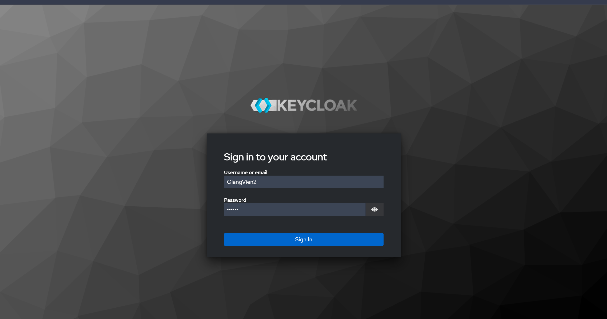
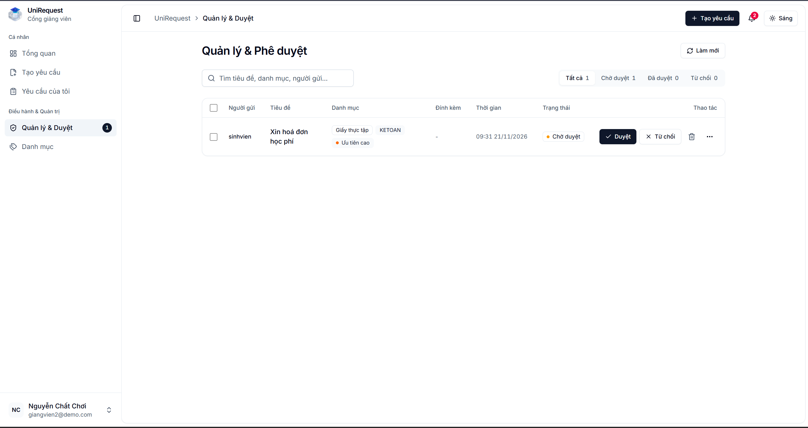
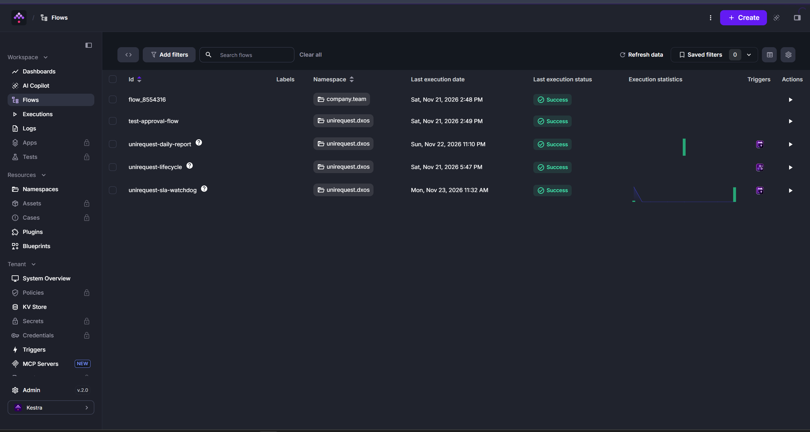
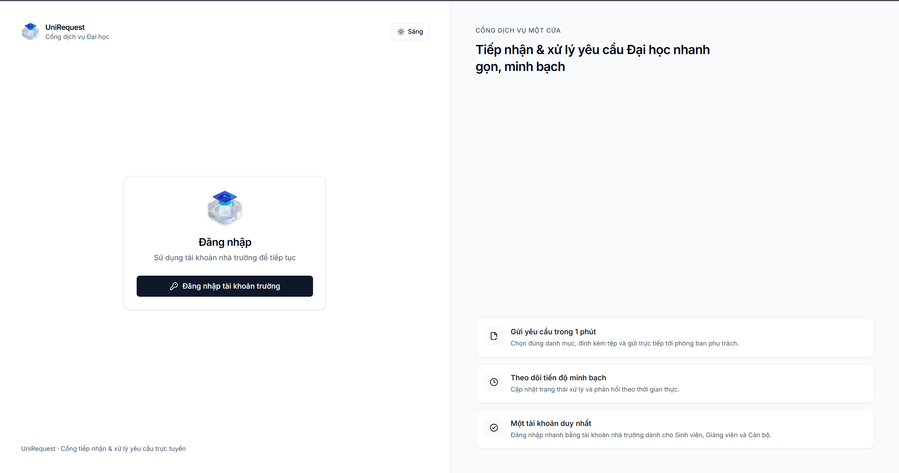
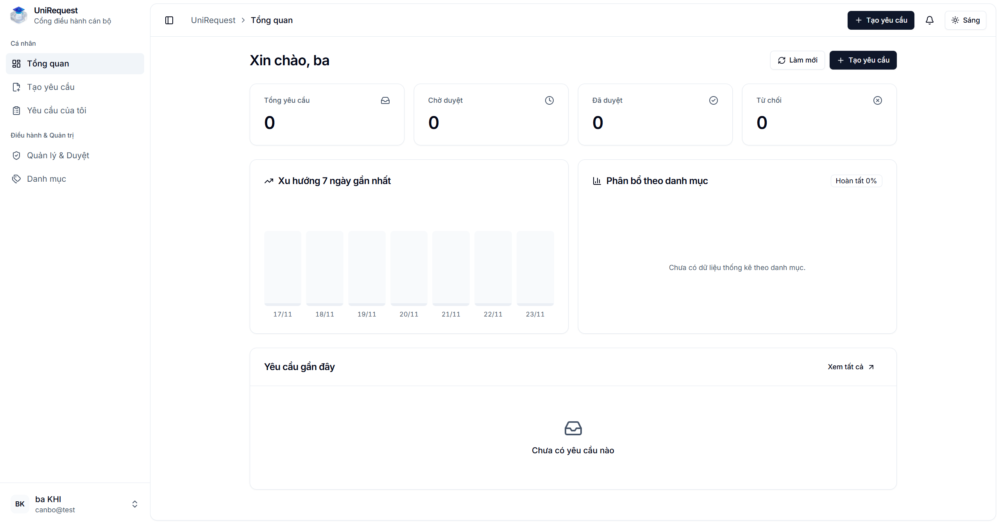
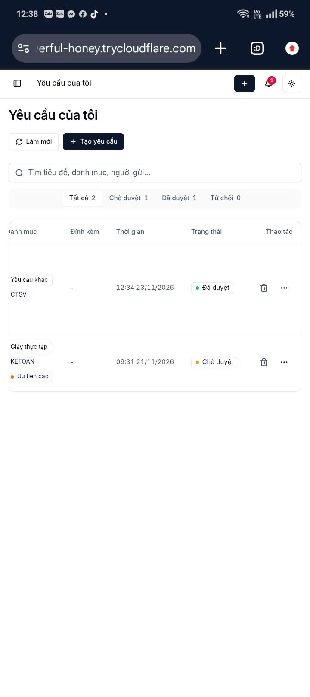

<p align="center">
  
</p>


# UniRequest-OS

> **Lõi nền tảng nguồn mở theo kiến trúc DX-OS, tự cài bằng một lệnh, bảo chứng dữ liệu bằng sổ cái SHA-256 và kiểm dịch tệp ngay trên bộ nhớ** - kèm ứng dụng đầu tiên chạy trên lõi: **Cổng dịch vụ Một cửa Đại học** tiếp nhận, định tuyến theo phòng ban và xử lý yêu cầu theo thời gian thực.

[](LICENSE)
[](https://olp.vn)
[](docker-compose.yml)

Sản phẩm dự thi **Olympic Tin học Sinh viên Việt Nam 2026 - nội dung Phần mềm Nguồn mở (OLP PMNM 2026)**, chủ đề DX-OS Open-Core.

**Đọc nhanh:** [Giới thiệu](#giới-thiệu) · [Thách thức &amp; Giải pháp](#thách-thức--giải-pháp) · [Đối tượng](#đối-tượng-sử-dụng) · [Chức năng](#chức-năng) · [Sản phẩm Demo](#sản-phẩm-demo) · [Kiến trúc](#kiến-trúc) · [Công nghệ](#công-nghệ-và-giấy-phép) · [Cài đặt từ máy sạch](#cài-đặt-từ-máy-sạch) · [Vận hành &amp; Sự cố](#vận-hành-và-xử-lý-sự-cố) · [Giấy phép &amp; Minh bạch AI](#giấy-phép-tham-khảo-và-minh-bạch-ai) · [CHANGELOG](#changelog)

---

## Giới thiệu

Tại nhiều trường đại học, mỗi học kỳ phát sinh hàng nghìn yêu cầu từ sinh viên và giảng viên như xin giấy xác nhận, gia hạn học phí, phúc khảo bảng điểm hay báo hỏng thiết bị. Việc xử lý qua đơn giấy, email rời rạc hoặc nhóm chat riêng lẻ tạo ra các **ốc đảo dữ liệu**, không truy vết được lịch sử phê duyệt và khiến nhà trường lệ thuộc vào phần mềm đóng (mất **chủ quyền số**).

**UniRequest-OS** tách toàn bộ phần hạ tầng dùng chung thành một **lõi chạy ngầm không giao diện** lắp từ phần mềm nguồn mở chuẩn OSI, đi kèm **Cổng dịch vụ Đại học** chạy phía trên qua một cổng API duy nhất.

## Thách thức & Giải pháp

- **Ốc đảo dữ liệu & thiếu truy vết -> Tập trung & Sổ cái SHA-256:** Mọi yêu cầu, trao đổi và phê duyệt đều lưu tại PostgreSQL 16 và nối chuỗi băm `SHA-256` từ `GENESIS` trong `request_audit_logs`; hành vi chỉnh sửa trái phép bị phát hiện ngay khi mở chi tiết đơn.
- **Tệp đính kèm thiếu kiểm soát -> Kiểm dịch Magic Bytes trên RAM:** Hệ thống chặn phần mở rộng nguy hiểm (`.exe`, `.sh`, `.svg`, `.html`, `.js`) và đối chiếu chữ ký nhị phân thực tế trong RAM Buffer trước khi đẩy lên MinIO S3.
- **Định tuyến cứng & xung đột xóa 2 phía -> Cây Group động & Soft-Delete độc lập:** Đồng bộ trực tiếp cây phòng ban/lớp học từ Keycloak Admin API (`/api/departments`); người gửi xóa lịch sử (`hidden_by_sender`) không làm mất đơn bên phòng ban tiếp nhận (`hidden_by_receiver`) và ngược lại.
- **Chọn nhầm phòng ban & khó chạy từ xa -> Hybrid AI `[I]` & Same-Origin HTTPS:** Trợ lý AI tại chỗ gợi ý Phòng ban, Danh mục, Độ ưu tiên; toàn bộ Portal, SSO `/auth`, REST/Socket.IO `/api` và tệp MinIO đi qua Nginx Same-Origin + Caddy HTTPS hoặc Tunnel để mở trên mọi điện thoại.

| Bảo chứng cốt lõi                                                                                   | Thành phần đảm nhiệm                 | Tầng / Lớp |
| :------------------------------------------------------------------------------------------------------ | :---------------------------------------- | :----------: |
| **Biết ai đã thực hiện** (OIDC PKCE `S256`, JWT `RS256` kèm `roles` + `groups`)     | Keycloak 26.0, Kong Gateway               |   Tầng 1   |
| **Tệp sạch trước khi lưu** (kiểm tra Magic Bytes nhị phân ngay trong RAM)                 | `upload-middleware` + `file-security` |   Tầng 1   |
| **Không sửa lén được** (chuỗi băm `SHA-256` liên kết `prev_hash` -> `entry_hash`) | PostgreSQL 16 + `audit-hash-chain`      |   Tầng 1   |
| **Giám sát SLA & xuất báo cáo tự động** (Webhook, Watchdog quá hạn, CSV cuối ngày)    | Kestra OSS (`Apache-2.0`)               |   Tầng 1   |

---

## Đối tượng sử dụng

| Vai trò Keycloak       | Nhóm / Phạm vi mặc định                     | Mục đích sử dụng chính                                                                                                                                 |
| :---------------------- | :----------------------------------------------- | :----------------------------------------------------------------------------------------------------------------------------------------------------------- |
| **`sinhvien`**  | `/Lớp/K11A1`, `/Lớp/k11A2` (`PERSONAL`)  | Gửi yêu cầu, dùng AI `[I]` gợi ý phân tuyến, đính kèm minh chứng, trao đổi 2 chiều, nhận thông báo, xóa lịch sử cá nhân & in phiếu |
| **`canbo`**     | `/CTSV` hoặc Ban bất kỳ (`DEPARTMENT`)    | Tiếp nhận, xem thẻ AI `[I]` và huy hiệu SHA-256, trao đổi, duyệt/từ chối và quản trị danh mục riêng của Ban                                |
| **`giangvien`** | `/KETOAN` hoặc Khoa/Bộ môn (`DEPARTMENT`) | Xử lý yêu cầu chuyên môn/học vụ và quản trị danh mục thuộc đơn vị phụ trách                                                                |
| **`admin`**     | Quản trị qua Keycloak Admin Console (`ALL`)  | Quản trị phân quyền, cây Group phòng ban và giám sát toàn hệ thống                                                                               |

---

## Chức năng

| Chức năng                                        | Cơ chế thực hiện trong UniRequest-OS                                                                                                                                                          |    Không gian    |
| :------------------------------------------------- | :------------------------------------------------------------------------------------------------------------------------------------------------------------------------------------------------ | :---------------: |
| **Đăng nhập một lần & PWA**             | Keycloak OIDC PKCE `S256`; giao diện React 19 tối giản (Sáng/Tối), Workbox PWA cài đặt được, Socket.IO và Web Push VAPID theo Ban                                                   |      `[H]`      |
| **Định tuyến & Danh mục theo Ban**       | Đồng bộ đệ quy cây Group Keycloak (`/api/departments`); mỗi Ban tự CRUD, bật/tắt và xóa nhiều danh mục thuộc phạm vi mình                                                      |      `[P]`      |
| **Xóa độc lập hai phía**                | Checkbox chọn nhiều xóa gọn ở *Lịch sử* hay *Hàng đợi* mà không ảnh hưởng phía đối diện; tự động xóa vật lý khi cả hai bên đã xóa                               |      `[P]`      |
| **Kiểm soát đầu vào & Sổ cái**        | Ràng buộc 2 lớp (phòng ban, minh chứng, lý do từ chối); kiểm tra Magic Bytes upload; xác minh toàn vẹn chuỗi băm `SHA-256` trên từng đơn                                      | Tầng 1 / `[D]` |
| **Tự động hóa Kestra GitOps**            | 3 workflows `unirequest.dxos`: điều phối Webhook vòng đời, Watchdog quét quá hạn SLA (chống lặp 6 giờ), xuất báo cáo CSV hằng ngày lên MinIO                                  | `[P]` / `[D]` |
| **Dashboard điều hành**                   | Biểu đồ xu hướng 7 ngày, phân bổ danh mục, tỷ lệ hoàn tất và thời gian xử lý trung bình lọc theo đúng phạm vi quyền                                                        |      `[D]`      |
| **Trợ lý phân tuyến AI chạy tại chỗ** | `POST /api/requests/ai-suggest` ưu tiên **Ollama** nội bộ, tự động dự phòng bằng **Bộ suy luận Ngữ nghĩa Tiếng Việt**; người dùng luôn là người duyệt cuối |      `[I]`      |

> **Lưu ý về AI `[I]`:** AI chỉ **gợi ý** Phòng ban, Danh mục, Độ ưu tiên và tóm tắt cho Cán bộ; mọi gợi ý đều được đối chiếu lại với Group Keycloak và danh mục thật trong PostgreSQL để chống sai lệch, đồng thời chạy ổn định ngay cả khi máy chấm thi không có GPU hoặc mất mạng.

---

## Sản phẩm Demo

Toàn bộ ảnh dưới đây được chụp trực tiếp từ hệ thống UniRequest-OS đang chạy trên Docker/WSL2 và điện thoại qua kết nối HTTPS công khai ([chi tiết nguồn ảnh](docs/images/README.md)):

|                        Xác thực tập trung Keycloak SSO (OIDC PKCE `S256`)                        |                                 Cổng Giảng viên/Cán bộ thuộc Group `KETOAN`                                 |                   Điều phối 3 Workflows trên Kestra (`unirequest.dxos`)                   |
| :----------------------------------------------------------------------------------------------------: | :------------------------------------------------------------------------------------------------------------------: | :----------------------------------------------------------------------------------------------: |
| [](docs/images/screenshots/LoginKeyCloak.png) | [](docs/images/screenshots/CongGiangVien_KETOAN.png) | [](docs/images/screenshots/KestraFlow.png) |

<details>
<summary><strong>Xem thêm ảnh chụp: Giao diện đăng nhập 3D, Cách ly dữ liệu Lớp/Ban & Demo chạy trên điện thoại qua Internet HTTPS</strong></summary>

|                                 Giao diện đăng nhập tối giản                                 |                    Cách ly dữ liệu giữa Lớp `K11A1` và Ban `CTSV`                    |                               Chạy thực tế trên di động qua HTTPS Tunnel                               |
| :------------------------------------------------------------------------------------------------: | :--------------------------------------------------------------------------------------------: | :----------------------------------------------------------------------------------------------------------: |
| [](docs/images/screenshots/GiaoDienLogin.png) | [](docs/images/screenshots/CTSV_Group.png) | [](docs/images/screenshots/DemoQuaNginx.png) |

</details>

---

## Kiến trúc

[](docs/images/architecture-animated.svg)

UniRequest-OS bám sát **khung ba tầng của đề thi DX-OS Open-Core**:

- **Tầng 1 - Lõi không giao diện (Headless Core):** Keycloak, Kong Gateway, PostgreSQL 16 (kèm sổ cái SHA-256), MinIO S3, Kestra OSS, kiểm dịch tệp RAM và AI Triage Engine. Không chứa màn hình nghiệp vụ; toàn bộ giao tiếp đi qua cổng API.
- **Tầng 2 - Bốn không gian năng lực số `H-P-D-I`:** cung cấp các phân hệ Con người số `[H]`, Quy trình số `[P]`, Dữ liệu số `[D]` và Trí tuệ số `[I]`.
- **Tầng 3 - Ứng dụng nghiệp vụ (UniRequest Portal):** React 19 PWA + Express Domain API triển khai trọn gói qua Docker Compose.

Chỉ cổng **Nginx Same-Origin (`:3000`)** và **Kong Gateway (`:8000`)** mở điểm truy cập ra ngoài để bảo vệ biên mạng Zero-Trust. Xem chi tiết toàn bộ bộ sơ đồ UML 2.x BCE (Sequence, Use Case, State, Class, Deployment) tại [`docs/uml.md`](docs/uml.md).

---

## Công nghệ và giấy phép

| Lớp / Không gian  | Thành phần                            | Phiên bản / Chuẩn      |         Giấy phép OSI         | Vai trò                                                                          |
| :------------------ | :-------------------------------------- | :------------------------ | :------------------------------: | :-------------------------------------------------------------------------------- |
| Biên mạng         | Nginx + Kong Gateway                    | `alpine`, `3.7.1 OSS` | `BSD-2-Clause`, `Apache-2.0` | Same-Origin Proxy (`/api`, `/auth`, WS) & Rate-Limit, `X-Correlation-ID`    |
| TLS Internet        | Caddy *(profile `internet`)*        | `2-alpine`              |          `Apache-2.0`          | Reverse Proxy cấp chứng chỉ HTTPS tự động cho tên miền công cộng        |
| `[H]` Định danh | Keycloak                                | `26.0`                  |          `Apache-2.0`          | OIDC PKCE `S256`, JWT `RS256`, đồng bộ cây Group phòng ban               |
| `[P]` Quy trình  | Kestra OSS                              | `latest`                |     **`Apache-2.0`**     | 3 workflow GitOps YAML (Webhook vòng đời, Watchdog SLA, CSV)                   |
| `[D]` CSDL        | PostgreSQL                              | `16-alpine`             |      `PostgreSQL License`      | 7 bảng giao dịch, xóa 2 phía & chuỗi kiểm toán `SHA-256`                 |
| `[D]` Kho tệp    | MinIO S3 (`pgsty/silo`)               | `latest`                |  `AGPL-3.0` / `Apache-2.0`  | Lưu tệp đính kèm qua kiểm dịch & báo cáo CSV *(dịch vụ tách biệt)* |
| `[I]` Trí tuệ   | Ollama *(tùy chọn)* + Local NLP     | `qwen2.5:3b` / TS       |             `MIT`             | Phân tuyến Hybrid AI & tóm tắt yêu cầu tại chỗ                            |
| Ứng dụng          | Node.js 20, Express, React 19, Vite PWA | `v0.9.0`                |             `MIT`             | Domain API, Socket.IO, Web Push VAPID, Shadcn/UI & Workbox                        |

- **Lý do chọn Kestra OSS thay cho n8n:** n8n sử dụng *Sustainable Use License* (không phải giấy phép chuẩn OSI và hạn chế mục đích sử dụng thương mại), trong khi **Kestra OSS dùng `Apache-2.0`**, thuần cấu hình GitOps YAML, đáp ứng trọn vẹn quy chế phần mềm nguồn mở của OLP PMNM.
- **Cách ly thành phần copyleft:** Thành phần `AGPL-3.0` (`MinIO / pgsty/silo`) chạy như một dịch vụ Docker độc lập bằng image gốc và giao tiếp qua giao thức mạng S3/HTTP, không nhúng hay liên kết mã vào mã nguồn `Apache-2.0` của dự án.

---

## Cài đặt từ máy sạch

### Yêu cầu hệ thống

- **Hệ điều hành:** Linux (Ubuntu 22.04/24.04), macOS hoặc Windows qua **WSL 2**.
- **Công cụ:** Docker Engine `24.0+`, Docker Compose `v2.20+`, GNU Make `4.0+`.
- **Tài nguyên:** RAM tối thiểu `4 GB` *(khuyến nghị `6 GB`)*, ổ trống `>= 8 GB`.
- **Cổng mạng:** `3000` (Portal / Same-Origin Proxy), `4000` (Backend), `5432` (PostgreSQL), `8000`-`8001` (Kong), `8080` (Keycloak), `8085` (Kestra), `9000`-`9001` (MinIO).

### Khởi chạy bằng 1 lệnh

```bash
git clone https://github.com/vothuong1706/UniRequest-OS.git
cd UniRequest-OS
make build
# Đợi khoảng 20-40 giây để Keycloak nạp realm, Kong & Kestra khởi tạo, sau đó kiểm chứng:
make unit-test && make test
```

> Trên Windows 10/11 (WSL2), có thể bấm đúp vào [`scripts/windows/Start_UniRequest.bat`](scripts/windows/Start_UniRequest.bat).

### Mở bản demo công khai qua Internet HTTPS

- **Laptop / WSL2 (không cần tên miền, qua Cloudflare Quick Tunnel):** `bash scripts/internet-demo.sh`
- **VPS có tên miền riêng (tự động cấp TLS HTTPS qua Caddy):** `PUBLIC_DOMAIN=unirequest.domain.vn bash scripts/internet-demo.sh caddy`

### Tài khoản mẫu (tự động nạp từ `config/keycloak/realm-export.json`)

| Tài khoản | Mật khẩu | Vai trò | Nhóm Keycloak | Ghi chú |
| :--- | :---: | :--- | :--- | :--- |
| `sinhvien` | `Admin@123` | `sinhvien` | `/Lớp/K11A1` | Chỉ xem đơn cá nhân do chính mình tạo |
| `sinhvien2` | `1234567` | `sinhvien` | `/Lớp/k11A2` | Tách biệt hoàn toàn dữ liệu với `sinhvien` |
| `canbo` | `123456` | `canbo` | `/CTSV` | Tiếp nhận và xử lý đơn thuộc Ban `CTSV` |
| `giangvien` | `123456` | `giangvien` | `/KETOAN` | Tiếp nhận và xử lý đơn thuộc Ban `KETOAN` |
| *Admin hệ thống* | *Đặt trong `.env`* | `admin` | Keycloak Console | Không cài mật khẩu mặc định trong realm |

### Địa chỉ truy cập các dịch vụ

| Dịch vụ | Địa chỉ truy cập | Ghi chú |
| :--- | :--- | :--- |
| **UniRequest Portal (Giao diện chính)** | <http://localhost:3000> | Điểm vào chính của người dùng (Nginx tự proxy `/api` và `/auth`) |
| **Kestra Workflow Engine UI** | <http://localhost:8085> | `admin@unirequest.edu.vn` / `KestraAdmin2026!` |
| **Keycloak Admin Console** | <http://localhost:8080> | Tài khoản `KC_ADMIN_USER` / `KC_ADMIN_PASSWORD` trong `.env` |
| **MinIO S3 Console** | <http://localhost:9001> | Tài khoản `MINIO_ROOT_USER` / `MINIO_ROOT_PASSWORD` trong `.env` |
| **Kiểm tra sức khỏe API (qua Kong)** | <http://localhost:8000/api/health> | Kong Gateway chỉ định tuyến `/api/*` và `/auth/*` *(cổng gốc `/` không mở UI)* |

---

## Vận hành và xử lý sự cố

| Lệnh                              | Tác dụng kiểm tra / vận hành                                            | Kết quả xác minh gần nhất                  |
| :--------------------------------- | :--------------------------------------------------------------------------- | :---------------------------------------------- |
| `make ps`                        | Xem trạng thái toàn bộ container                                         | 8/8 dịch vụ đang hoạt động                |
| `make unit-test`                 | Chạy Vitest + Supertest (AI, Magic Bytes, SHA-256, Scope, UI Utils)         | Backend `33/33` + Frontend `9/9` đạt 100% |
| `make lint`                      | Kiểm tra `tsc`, ESLint, Prettier, Vite PWA, Compose & Realm JSON          | Đạt 100%                                      |
| `make test`                      | Kịch bản E2E 7 bước (Kong, OIDC, JWT 401, MinIO, PWA, Socket.IO, Kestra) | Đạt `7/7` bước chuẩn                     |
| `make backup` / `make restore` | Sao lưu PostgreSQL + MinIO và kiểm chứng checksum `SHA256SUMS`         | Xác minh phục hồi toàn vẹn                 |

| Sự cố thường gặp                                     | Cách xử lý                                                                                                                                          |
| :-------------------------------------------------------- | :----------------------------------------------------------------------------------------------------------------------------------------------------- |
| Trùng cổng `3000`, `8000` hoặc `8080`            | Dừng tiến trình chiếm cổng hoặc chỉnh mapping cổng trong `docker-compose.yml` rồi chạy lại `make build`                                 |
| Mở bằng IP LAN không đăng nhập được Keycloak     | Trình duyệt chỉ cho phép Web Crypto PKCE S256 trên `localhost` hoặc `https://`; chạy `bash scripts/internet-demo.sh` để dùng qua HTTPS |
| Chưa cài Ollama / không có GPU                        | Hệ thống tự động fallback sang `rule-nlp-engine` tiếng Việt nội bộ trong vài mili-giây, không ảnh hưởng chức năng                   |
| Upload bị chặn HTTP 400 `UNSUPPORTED_OR_SPOOFED_FILE` | Trạm kiểm dịch từ chối tệp có đuôi nguy hiểm (`.exe`, `.sh`, `.svg`, `.html`) hoặc nội dung nhị phân giả mạo phần mở rộng   |

---

## Giấy phép, Tham khảo và Minh bạch AI

### 1. Giấy phép nguồn mở (`Apache License 2.0`)

Toàn bộ mã nguồn và tài liệu do nhóm phát triển trong **UniRequest-OS** được phát hành theo **[Apache License 2.0](LICENSE)** kèm thông báo bản quyền thành phần thứ ba tại **[`NOTICE`](NOTICE)**.

**Vì sao chọn Apache-2.0:** Đây là giấy phép nguồn mở dễ áp dụng (*permissive*) được OSI phê duyệt, cho phép các trường đại học tự do sử dụng, tùy biến và triển khai nội bộ mà không gặp rào cản copyleft chặt; đồng thời có điều khoản cấp quyền bằng sáng chế (*patent grant*) và yêu cầu giữ thông báo ghi nhận trong `NOTICE`, đồng nhất với giấy phép của các lõi chính (Keycloak, Kong, Kestra).

### 2. Ghi nhận Dự án Tham khảo & Tài nguyên bên ngoài

- **Dự án tham khảo từ cộng đồng OLP DX-OS:**
  - **[Signet (HIT-Champion)](https://github.com/HIT-Champion/Signet):** Tham khảo phương pháp phân tách khung 3 tầng DX-OS, bố cục sơ đồ kiến trúc động 4 không gian `H-P-D-I` và văn phong đặc tả kỹ thuật.
  - **[Disaster DX-OS (DTU_DZ_1)](https://github.com/disaster-dxos/disaster-dxos):** Tham khảo cấu trúc chuẩn hóa README nguồn mở, quy chuẩn minh bạch giấy phép và công khai sử dụng công cụ AI.
- **Thư viện & Công cụ bên thứ ba:** Bộ icon `lucide-react` (`ISC License`) và các Docker image nguồn mở thượng nguồn (Keycloak, Kong, Kestra, PostgreSQL, MinIO, Caddy, Nginx) được liệt kê đầy đủ trong [`NOTICE`](NOTICE).

### 3. Công khai Minh bạch các phần có sử dụng AI

1. **Hình ảnh minh họa (`docs/images/`):** Các tệp `logo-3d.png`, `banner.jpg` và `hpdi-overview.jpg` được tạo bằng công cụ AI tạo ảnh; các sơ đồ `architecture-animated.svg`, `architecture.png`, `workflow-animated.svg` và `uml-*.svg` do nhóm thiết kế bằng mã SVG với sự hỗ trợ của AI. Toàn bộ danh sách và nguồn gốc từng ảnh được ghi rõ tại [`docs/images/README.md`](docs/images/README.md).
2. **Tính năng AI trong sản phẩm (`[I]` Intelligence):** Module `AiTriageService` sử dụng mô hình cục bộ (`Ollama`) kết hợp bộ luật ngữ nghĩa tiếng Việt, chỉ đưa ra gợi ý hỗ trợ và không tự ý duyệt hay tạo đơn thay con người.
3. **Hỗ trợ phát triển (AI Coding Assistant):** Nhóm có sử dụng trợ lý AI để hỗ trợ viết mã mẫu, rà soát bảo mật/lint và biên tập tài liệu kỹ thuật; mọi mã nguồn, luồng nghiệp vụ và kết quả kiểm thử đều do nhóm trực tiếp thiết kế, nghiệm thu và chạy kiểm chứng trên hệ thống thật.

---

## CHANGELOG

- **`v0.9.0`:** Hoàn thiện Không gian `[I]` Hybrid AI Triage (`POST /api/requests/ai-suggest`), mở khóa demo Internet HTTPS (`Same-Origin Proxy` + `Caddyfile` + Keycloak Dynamic URIs + proxy MinIO `/api/upload/files`), gia cố Tầng 1 với trạm kiểm dịch Magic Bytes (`file-security.ts`), chuỗi băm kiểm toán SHA-256 (`11-audit-hash-chain.sql`) và `make backup` / `make restore` kèm `SHA256SUMS`.
- **`v0.7.0`:** Định tuyến phòng ban động theo cây Group Keycloak (`/api/departments`), danh mục tách Ban, xóa độc lập 2 phía (`hidden_by_sender` / `hidden_by_receiver`) và bộ 3 workflow Kestra (`lifecycle`, `sla-watchdog`, `daily-report`).
- **`v0.6.0`:** Socket.IO realtime qua Kong, Trung tâm thông báo (`notification_reads`), Bình luận 2 chiều (`request_comments`), PWA Workbox và Web Push VAPID.
- **`v0.1.0 - v0.5.0`:** Nền tảng Docker Compose (Keycloak, Kong, PostgreSQL, MinIO, Kestra), React 19 + Shadcn/UI, `request_audit_logs`, Danh mục động và Dashboard 7 ngày.
