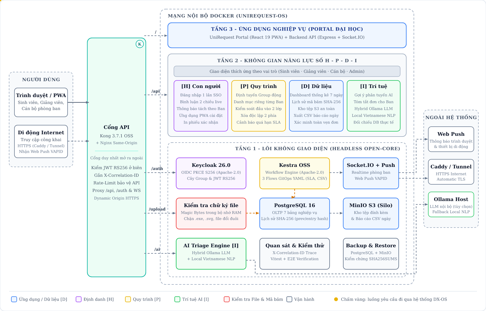

<p align="center">
  
</p>


# UniRequest-OS: Nền tảng Quản lý Yêu cầu Đại học (Student Request Management)

> Giúp trường đại học số hóa toàn diện quy trình tiếp nhận yêu cầu sinh viên, tự động định tuyến đến đúng phòng ban theo cây tổ chức và xử lý theo thời gian thực.

[](LICENSE)
[](https://olp.vn)
[](docker-compose.yml)
[](apps/demo-app/package.json)
[](apps/backend-api/package.json)
[](config/keycloak/realm-export.json)
[](config/kestra/flows)

---

## Giới thiệu

Tại nhiều trường đại học, mỗi học kỳ phát sinh hàng nghìn yêu cầu từ sinh viên và giảng viên như xin giấy xác nhận, gia hạn học phí, phúc khảo bảng điểm hay báo hỏng thiết bị. Việc tiếp nhận rời rạc qua đơn giấy, email hoặc nhóm chat tạo ra các **ốc đảo dữ liệu**, thiếu minh bạch tiến độ và khiến nhà trường phụ thuộc vào phần mềm đóng.

**UniRequest-OS** giải quyết bài toán này bằng kiến trúc **DX-OS Open-Core 3 tầng** hoàn toàn nguồn mở: tách bạch phần hạ tầng lõi chạy ngầm (`Keycloak`, `Kong`, `Kestra`, `PostgreSQL`, `MinIO`) khỏi ứng dụng Cổng Một cửa Đại học (`React 19 PWA` + `Node.js/Express`). Nhà trường tự chủ hoàn toàn dữ liệu và dễ dàng mở rộng thêm nhiều phân hệ nghiệp vụ trên cùng một nền tảng lõi.

---

## Quick Start (Chạy bằng 1 lệnh)

- **Yêu cầu hệ thống:** Docker Engine `24.0+`, Docker Compose `v2.20+`, GNU Make `4.0+`, RAM `>= 4 GB` *(khuyến nghị `6 GB`)*.

```bash
git clone https://github.com/vothuong1706/UniRequest-OS.git
cd UniRequest-OS
make build
# Đợi 20-40 giây để Keycloak, Kong & Kestra nạp cấu hình, sau đó kiểm chứng:
make unit-test && make test
```

> Trên Windows WSL2, có thể bấm đúp [`scripts/windows/Start_UniRequest.bat`](scripts/windows/Start_UniRequest.bat). Để mở link demo HTTPS công khai trên điện thoại, chạy `bash scripts/internet-demo.sh`.

### Tài khoản kiểm thử (`config/keycloak/realm-export.json`)

| Tài khoản | Mật khẩu | Vai trò | Nhóm Keycloak | Phạm vi dữ liệu |
| :--- | :---: | :--- | :--- | :--- |
| `sinhvien` | `Admin@123` | `sinhvien` | `/Lớp/K11A1` | Chỉ xem đơn cá nhân do chính mình tạo |
| `sinhvien2` | `1234567` | `sinhvien` | `/Lớp/k11A2` | Tách biệt hoàn toàn dữ liệu với `sinhvien` |
| `canbo` | `123456` | `canbo` | `/CTSV` | Tiếp nhận và xử lý đơn thuộc Ban `CTSV` |
| `giangvien` | `123456` | `giangvien` | `/KETOAN` | Tiếp nhận và xử lý đơn thuộc Ban `KETOAN` |
| *Admin hệ thống* | *Đặt trong `.env`* | `admin` | Keycloak Console | Quản trị qua Keycloak Console |

### Địa chỉ truy cập các dịch vụ

| Dịch vụ | Địa chỉ truy cập | Ghi chú |
| :--- | :--- | :--- |
| **UniRequest Portal (Chính)** | <http://localhost:3000> | Giao diện chính cho người dùng (Nginx tự proxy `/api` và `/auth`) |
| **Kestra Workflow Engine UI** | <http://localhost:8085> | `admin@unirequest.edu.vn` / `KestraAdmin2026!` |
| **Keycloak Admin Console** | <http://localhost:8080> | `KC_ADMIN_USER` / `KC_ADMIN_PASSWORD` trong `.env` |
| **MinIO S3 Console** | <http://localhost:9001> | `MINIO_ROOT_USER` / `MINIO_ROOT_PASSWORD` trong `.env` |
| **Kong API Gateway (Health)** | <http://localhost:8000/api/health> | Kong chỉ định tuyến `/api/*` và `/auth/*` *(cổng gốc `/` không mở UI)* |

---

## MỤC 1: Giải pháp thiết kế và Lựa chọn công nghệ

UniRequest-OS tuân thủ **Khung kiến trúc 3 tầng của DX-OS**:

- **Tầng 1 - Lõi không giao diện (Headless Core):** `Keycloak 26.0` (định danh SSO), `Kong Gateway` (biên API, Rate-Limit, `X-Correlation-ID`), `Kestra OSS` (điều phối workflow), `PostgreSQL 16` (dữ liệu & sổ cái SHA-256), `MinIO S3` (lưu trữ tệp qua kiểm dịch RAM) và `AI Triage Engine`.
- **Tầng 2 - Không gian năng lực số `H-P-D-I`:** Cung cấp các phân hệ dùng chung cho Con người số `[H]`, Quy trình số `[P]`, Dữ liệu số `[D]` và Trí tuệ số `[I]`.
- **Tầng 3 - Ứng dụng nghiệp vụ (UniRequest Portal):** Giao diện `React 19 PWA` + `Express API` phục vụ bài toán Một cửa Đại học, giao tiếp qua Nginx Same-Origin (`:3000`) và Kong (`:8000`) *(các cổng quản trị còn lại mở cục bộ trong [`docker-compose.yml`](docker-compose.yml) để phục vụ kiểm tra/chấm thi)*.

[](docs/images/architecture-animated.svg)

> Xem bộ sơ đồ UML 2.x tại [`docs/uml.md`](docs/uml.md) · Bản đồ tài liệu 5 phút tại [`docs/README.md`](docs/README.md) · Kiến trúc & Dữ liệu tại [`docs/architecture.md`](docs/architecture.md) · Vận hành & Kiểm chứng tại [`docs/operations.md`](docs/operations.md).

| Thành phần | Công nghệ & Chuẩn | Giấy phép OSI | Vai trò trong UniRequest-OS |
| :--- | :--- | :---: | :--- |
| Định danh `[H]` | **Keycloak** `26.0` | `Apache-2.0` | OIDC PKCE `S256`, JWT `RS256`, cây Group phòng ban |
| Biên mạng | **Kong OSS** `3.7.1` + Nginx + Caddy | `Apache-2.0`, `BSD` | Proxy `/api`, `/auth`, Socket.IO, Rate-Limit & Auto-HTTPS |
| Quy trình `[P]` | **Kestra OSS** (`unirequest.dxos`) | **`Apache-2.0`** | 3 workflow GitOps YAML (Webhook vòng đời, SLA Watchdog, CSV) |
| Dữ liệu `[D]` | **PostgreSQL** `16-alpine` | `PostgreSQL` | 7 bảng giao dịch, xóa 2 phía & chuỗi kiểm toán `SHA-256` |
| Kho tệp `[D]` | **MinIO S3** (`pgsty/silo`) | `AGPL-3.0` / `Apache-2.0` | Lưu tệp đính kèm qua kiểm dịch Magic Bytes *(dịch vụ tách biệt)* |
| Trí tuệ `[I]` | **Ollama** *(tùy chọn)* + Local NLP | `MIT` | Phân tuyến Hybrid AI tiếng Việt & tóm tắt yêu cầu cho Cán bộ |
| Ứng dụng | **React 19 PWA**, Node.js `20`, Express | `MIT` | Giao diện Sáng/Tối, Workbox PWA, Socket.IO & Web Push VAPID |

- **Vì sao chọn Kestra OSS thay cho n8n:** n8n sử dụng *Sustainable Use License* (không phải giấy phép chuẩn OSI và hạn chế thương mại), trong khi **Kestra OSS dùng `Apache-2.0`**, thuần cấu hình GitOps YAML, đáp ứng trọn vẹn quy chế nguồn mở của OLP PMNM 2026.

---

## MỤC 2: Tính năng Nền tảng và Bài toán Nghiệp vụ

- **`[H]` Con người số (Human):** Đăng nhập một lần qua Keycloak SSO; giao diện React 19 PWA tối giản cài đặt được trên Desktop/Mobile; bình luận 2 chiều, thông báo Socket.IO và Web Push VAPID gửi đúng phòng ban.
- **`[P]` Quy trình số (Process):** **Định tuyến động theo cây Group Keycloak** (`/api/departments`), cho phép mỗi Ban tự quản lý danh mục riêng; xóa độc lập 2 phía (`hidden_by_sender` / `hidden_by_receiver`); và bộ 3 workflow Kestra tự động điều phối, cảnh báo SLA quá hạn (`*/15 * * * *`).
- **`[D]` Dữ liệu số (Data):** Chuỗi băm `SHA-256` (`prev_hash -> entry_hash`) trong `request_audit_logs` phát hiện mọi chỉnh sửa trái phép; trạm kiểm dịch `Magic Bytes` ngay trên RAM chặn tệp giả mạo trước khi lưu MinIO; Dashboard thống kê 7 ngày (`+07:00`) và xuất báo cáo CSV hằng ngày.
- **`[I]` Trí tuệ số (Intelligence):** Gợi ý tự động Phòng ban, Danh mục và Độ ưu tiên bằng **Hybrid AI** (`POST /api/requests/ai-suggest` ưu tiên Ollama, dự phòng bộ NLP tiếng Việt nội bộ trong vài mili-giây), luôn đối chiếu Group/Danh mục thật và để con người duyệt cuối.

**Luồng nghiệp vụ chính:** Sinh viên gửi đơn (AI `[I]` gợi ý phòng ban & danh mục) → Kong Gateway kiểm tra biên mạng & Backend lưu DB + Audit `SHA-256` → Kestra kích hoạt workflow & đặt ngưỡng SLA → Cán bộ đúng Ban nhận thông báo realtime & phê duyệt → Đồng bộ trạng thái tức thì cho Sinh viên.

---

## MỤC 3: Kết quả Sản phẩm và Demo

Toàn bộ ảnh dưới đây chụp trực tiếp từ hệ thống đang chạy trên Docker/WSL2 và điện thoại qua HTTPS công khai (xem trọn bộ 11 ảnh tại [`docs/images/README.md`](docs/images/README.md)):

| Cổng Giảng viên/Cán bộ (`KETOAN`) | Điều phối 3 Workflows trên Kestra | Xác thực Keycloak SSO (`PKCE S256`) | Demo di động qua HTTPS Tunnel |
| :---: | :---: | :---: | :---: |
| [](docs/images/screenshots/CongGiangVien_KETOAN.png) | [](docs/images/screenshots/KestraFlow.png) | [](docs/images/screenshots/LoginKeyCloak.png) | [](docs/images/screenshots/DemoQuaNginx.png) |

| Lệnh kiểm thử / vận hành | Phạm vi xác minh | Kết quả |
| :--- | :--- | :--- |
| `make unit-test` | Vitest + Supertest độc lập (AI, Magic Bytes, SHA-256, Scope, UI Utils; không cần Docker) | Backend `33/33` + Frontend `9/9` (**42/42 đạt 100%**) |
| `make lint` | TypeScript `tsc`, ESLint, Prettier, Vite PWA build, Docker Compose & Realm JSON | **Đạt 100%** |
| `make test` | E2E 7 bước trên 8 container (Kong, OIDC, Health, 6x JWT `401`, MinIO, PWA, Socket.IO, Kestra) | **7/7 bước đạt chuẩn** |
| `make backup` / `make restore` | Đóng gói snapshot PostgreSQL + MinIO kèm kiểm tra toàn vẹn `SHA256SUMS` | **Phục hồi toàn vẹn 100%** |

---

## MỤC 4: Định hướng Phát triển

- **Hồ dữ liệu Ấm - Lạnh (Lakehouse):** Tích hợp `Redpanda` + `Apache Iceberg` + `Trino/DuckDB` đồng bộ lịch sử giao dịch sang kho phân tích đa năm học cho Ban Giám hiệu mà không ảnh hưởng tốc độ PostgreSQL OLTP.
- **Trí tuệ nhân tạo `[I]` chuyên sâu (RAG + Qdrant):** Kết hợp cơ sở dữ liệu véc-tơ `Qdrant` trên bộ quy chế đào tạo và sổ tay sinh viên của từng trường để AI trích dẫn điều khoản và gợi ý phản hồi chuẩn.
- **Giám sát & Bảo mật nâng cao:** Bổ sung xác thực đa yếu tố `WebAuthn/TOTP` cho tài khoản cán bộ/quản trị, chuẩn hóa tài liệu API (`Zod + OpenAPI`) và bộ giám sát `Prometheus + Grafana`.

---

## Giấy phép, Ghi nhận & CHANGELOG

- **Cuộc thi:** Sản phẩm dự thi **Olympic Tin học Sinh viên Việt Nam 2026 - Khối Phần mềm Nguồn mở (OLP PMNM 2026)**, chủ đề DX-OS Open-Core.
- **Giấy phép:** Phát hành theo **[Apache License 2.0](LICENSE)** kèm thông báo thành phần bên thứ ba tại **[`NOTICE`](NOTICE)**.
- **Tham khảo & Minh bạch AI:** Tham khảo phương pháp trình bày kiến trúc 3 tầng DX-OS từ [Signet](https://github.com/HIT-Champion/Signet) và chuẩn mực minh bạch tài liệu từ [Disaster DX-OS](https://github.com/disaster-dxos/disaster-dxos). Toàn bộ mã nguồn, luồng nghiệp vụ và kiểm thử do nhóm tự thiết kế và xác minh; các ảnh minh họa trong `docs/images/`, gợi ý phân tuyến AI `[I]` và việc sử dụng trợ lý AI biên tập tài liệu/mã mẫu đều được công khai tại [`docs/images/README.md`](docs/images/README.md) và [`NOTICE`](NOTICE).
- **CHANGELOG:**
  - `v0.9.0`: Hoàn thiện AI `[I]` (`POST /api/requests/ai-suggest`), demo Internet HTTPS (`Same-Origin Proxy` + `Caddyfile`), kiểm dịch Magic Bytes, sổ cái `SHA-256` và `make backup`/`restore`.
  - `v0.7.0`: Định tuyến phòng ban động theo cây Group Keycloak, danh mục tách Ban, xóa độc lập 2 phía và bộ 3 workflow Kestra (`unirequest.dxos`).
  - `v0.6.0`: Socket.IO realtime qua Kong, Trung tâm thông báo, Bình luận 2 chiều, Workbox PWA và Web Push VAPID.
