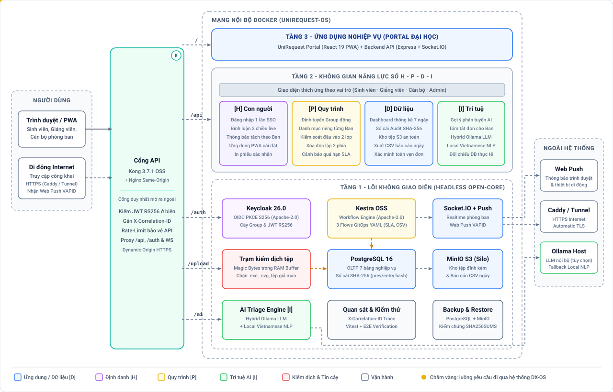

<p align="center">
  
</p>

<h1 align="center">UniRequest-OS</h1>

<p align="center">
  <strong>Nền tảng Nguồn mở Tiếp nhận &amp; Xử lý Yêu cầu Đại học (Two-Tier Open-Core)</strong><br />
  <em>Open-Source University Service Request &amp; Workflow Platform</em>
</p>

<p align="center">
  <a href="LICENSE"></a>
  
  
  
  
</p>


**UniRequest-OS** là nền tảng nguồn mở kiến trúc 2 tầng tách biệt giúp các trường đại học số hóa toàn bộ quy trình tiếp nhận yêu cầu từ sinh viên và giảng viên, quản lý danh mục yêu cầu động theo phòng ban, lưu trữ tệp đính kèm S3, trao đổi trực tiếp theo thời gian thực, thông báo đa kênh (In-App + Web Push), hỗ trợ cài đặt ứng dụng PWA và tự động điều phối bằng Workflow Engine.

**University Digital Service Portal:** a decoupled two-tier open-source platform that digitizes university service requests with dynamic database-driven categories, S3 attachment storage, realtime Socket.IO messaging and notifications, installable PWA with Web Push (VAPID), declarative GitOps workflow routing, and auditable role-based approvals for students, lecturers, and administrative staff.

**English readers:** every section below includes an English summary. To spin up the full stack in one command, jump straight to [Quick start (English)](#-quick-start-english).

**Mục lục · Contents:** [Giới thiệu](#-giới-thiệu--introduction) · [Thách thức](#️-thách-thức--challenges) · [Giải pháp](#-giải-pháp--solution) · [Đối tượng](#-đối-tượng--users) · [Chức năng](#-chức-năng--features) · [Kiến trúc động](#️-kiến-trúc--architecture) · [Công nghệ](#️-công-nghệ--technology) · [Luồng nghiệp vụ](#-luồng-nghiệp-vụ--business-flows) · [Hướng phát triển](#-hướng-phát-triển--roadmap) · [Cài đặt từ máy sạch](#️-cài-đặt-từ-máy-sạch) · [Quick start](#-quick-start-english) · [Đóng góp](#-đóng-góp--contributing) · [Giấy phép](#-giấy-phép--license) · [CHANGELOG](#-changelog)

---

## 🧭 Giới thiệu · Introduction

Tại nhiều trường đại học, mỗi học kỳ có hàng nghìn yêu cầu từ sinh viên và giảng viên như xin giấy xác nhận sinh viên, đăng ký tín chỉ, phúc khảo bảng điểm, học phí/học bổng, mượn phòng học, hỗ trợ ký túc xá, hỗ trợ CNTT hay báo hỏng thiết bị phòng học. Phần lớn các thủ tục này vẫn đi qua đơn giấy, biểu mẫu rời rạc, nhóm chat hoặc email cá nhân - tạo thành các *"ốc đảo dữ liệu"*, khó truy vết ai đã xử lý và mất nhiều thời gian chờ đợi.

**UniRequest-OS** giải quyết bài toán này theo mô hình **Open-Core 2 tầng**: tách bạch **Tầng 1 (Nền tảng Dịch vụ Lõi Headless)** gồm 4 dịch vụ cốt lõi (Identity/SSO, API Gateway, Dữ liệu cấu trúc/phi cấu trúc, Workflow Engine) khỏi **Tầng 2 (Ứng dụng Cổng dịch vụ Đại học)** tối giản, dễ dùng và sẵn sàng triển khai thực tế.

At many universities, thousands of student and faculty requests - enrollment certificates, academic appeals, tuition support, room bookings, and facility repairs - are still handled through paper forms, scattered emails, and chat groups. **UniRequest-OS** separates a reusable **Tier 1 Headless Open-Core Platform** (SSO, API Gateway, PostgreSQL, MinIO S3, Kestra Workflow Engine) from a clean, production-ready **Tier 2 University Portal Application**.

---

## ⚠️ Thách thức · Challenges

- **Hồ sơ phân mảnh ("ốc đảo dữ liệu"):** Yêu cầu học vụ, xác nhận sinh viên, học bổng và báo hỏng cơ sở vật chất nằm rải rác ở nhiều phòng ban, không có nguồn sự thật duy nhất (*Single Source of Truth*).
- **Danh mục cứng nhắc, khó mở rộng:** Các phần mềm đóng thường cố định danh sách thủ tục trong mã nguồn, khiến nhà trường không thể chủ động thêm loại yêu cầu mới theo từng học kỳ.
- **Độ trễ phản hồi và thiếu trao đổi hai chiều:** Sinh viên phải liên tục tải lại trang để kiểm tra kết quả; cán bộ không có kênh nhắn trực tiếp để yêu cầu bổ sung giấy tờ trước khi quyết định.
- **Sai sót ngay từ đầu vào & thiếu minh bạch:** Gửi thiếu ảnh hiện trường khi báo hỏng hoặc chọn khẩn cấp không rõ lý do; không lưu lịch sử ai duyệt, duyệt lúc nào và vì sao bị từ chối.

*English:*
- **Fragmented data silos:** Requests live across disconnected channels with no single source of truth.
- **Rigid hardcoded forms:** Administrative offices cannot add or customize request types without developer intervention.
- **Delayed feedback & missing 2-way conversation:** Users must manually refresh to see status updates, and staff cannot ask clarifying questions inline.
- **Preventable input errors & lack of auditability:** Missing facility photos or unjustified urgent flags waste review time, with no immutable history.

---

## 💡 Giải pháp · Solution


- **Danh mục yêu cầu động 100% từ cơ sở dữ liệu:** Cài sẵn 9 nhóm dịch vụ đại học thực tế trong bảng `request_categories`; Cán bộ/Quản trị viên có thể tự thêm, sửa, lọc (*Tất cả / Đang bật / Đang ẩn*), bật/tắt danh mục và cấu hình phòng ban phụ trách + thời hạn SLA ngay trên giao diện **Danh mục** mà không cần sửa code. Biểu mẫu hỗ trợ Combobox tìm kiếm nhanh và tự nhập tên yêu cầu cụ thể khi chọn *"Yêu cầu khác"*.
- **Realtime Socket.IO, Trung tâm Thông báo & Web Push (VAPID):** Kết nối thời gian thực đi qua cổng **Kong Gateway** (`/api/socket.io`) xác thực bằng Keycloak JWT RS256. Thông báo lưu trạng thái đọc/chưa đọc/ẩn độc lập theo từng tài khoản (`notification_reads`), tự động đánh dấu đã đọc khi người dùng mở xem yêu cầu, đồng bộ đa tab tức thì và hỗ trợ đẩy thông báo hệ điều hành ngoài trình duyệt.
- **Trao đổi trực tiếp trong từng yêu cầu & PWA cài đặt được:** Sinh viên và cán bộ trao đổi hai chiều theo thời gian thực ngay trong chi tiết yêu cầu (`request_comments`). Ứng dụng web đóng gói chuẩn **PWA (`vite-plugin-pwa` + Workbox)** cho phép cài đặt lên màn hình chính Desktop/Mobile kèm cảnh báo Ngoại tuyến an toàn (không cache `/auth` hay API bảo mật).
- **Kiến trúc 2 tầng Open-Core & Tự động hóa GitOps YAML (Kestra Apache-2.0):** Toàn bộ Tầng 1 chạy ngầm (*headless*) qua Docker Compose; phân tuyến phòng ban và mức SLA được khai báo bằng tệp YAML độc lập.
- **Giao diện tối giản theo vai trò:** Tự động hiển thị đúng ngữ cảnh theo vai trò (*Cổng dịch vụ sinh viên*, *Cổng giảng viên*, *Cổng điều hành cán bộ*, *Quản trị hệ thống*), tách biệt Dashboard tối giản cho Sinh viên và biểu đồ xu hướng 7 ngày + phân bổ danh mục cho Cán bộ.

*English:*
- **100% Database-driven dynamic categories:** Ships with 9 university service categories in `request_categories`; staff can add, edit, filter, or toggle categories, assigned departments, SLA targets, and evidence requirements live from the UI.
- **Realtime Socket.IO, Per-user Notification Center & Web Push (VAPID):** Zero-Trust Socket.IO through Kong (`/api/socket.io`) with Keycloak JWT RS256, per-user read/unread/hide states, automatic read-on-open, multi-tab sync, and OS-level Web Push notifications.
- **Inline Request Comments & Installable PWA:** Two-way realtime comments inside every request plus a Workbox App Shell PWA (never caching OIDC/auth or authenticated APIs).
- **Reusable 2-Tier Open-Core & Kestra GitOps YAML:** Headless Tier 1 infrastructure services behind Kong with declarative workflow orchestration.

---

## 👥 Đối tượng · Users

| Đối tượng · *Who* | Mục đích sử dụng · *Uses it to* | Vai trò Keycloak · *Role* |
| :--- | :--- | :--- |
| **Sinh viên** · *Students* | Đăng nhập một cửa, chọn danh mục yêu cầu, đính kèm ảnh/PDF, trao đổi trực tiếp, nhận thông báo realtime/Web Push và in phiếu xác nhận | `sinhvien` |
| **Cán bộ phòng ban** · *Administrative Staff* | Quản lý toàn bộ yêu cầu, trao đổi & phê duyệt/từ chối kèm lý do, quản trị danh mục yêu cầu, theo dõi biểu đồ xu hướng 7 ngày | `canbo` |
| **Giảng viên** · *Lecturers* | Tiếp nhận, trao đổi và phê duyệt các yêu cầu học vụ, quản trị danh mục liên quan | `giangvien` |
| **Quản trị hệ thống** · *System Admin* | Quản trị phân quyền Keycloak, cấu hình danh mục & giám sát luồng xử lý Kestra | `admin` |

---

## 📱 Chức năng · Features

| Nhóm | Chức năng · *Feature* | Trạng thái (`v0.6.0`) |
| :---: | :--- | :--- |
| **Định danh** | **Đăng nhập tập trung SSO (Keycloak OIDC + PKCE S256)** | ✅ Không lưu mật khẩu trong DB ứng dụng; tự động gia hạn Bearer Token (`updateToken(30)`), tự nạp `realm-export.json` |
| **Giao diện** | **Cổng dịch vụ tối giản (React 19 + Shadcn/UI + Radix)** | ✅ Logo 3D nền trong suốt tương thích cả Sáng/Tối, tự động nhận diện ngữ cảnh cổng theo vai trò (*Cổng dịch vụ sinh viên* / *Cổng giảng viên* / *Cổng điều hành cán bộ* / *Quản trị hệ thống*) |
| **Realtime & Thông báo** | **Socket.IO qua Kong + Trung tâm Thông báo & Web Push (VAPID)** | ✅ Thông báo tức thì theo vòng đời yêu cầu & bình luận, lưu trạng thái đọc/chưa đọc/ẩn riêng từng người dùng (`notification_reads`), tự đánh dấu đọc khi mở yêu cầu, đồng bộ đa tab & đẩy thông báo ngoài trình duyệt |
| **Trao đổi** | **Bình luận trực tiếp trong chi tiết yêu cầu (`request_comments`)** | ✅ Trao đổi 2 chiều theo thời gian thực giữa người gửi và cán bộ phụ trách ngay trong hộp thoại chi tiết yêu cầu |
| **PWA** | **Ứng dụng web cài đặt được (`vite-plugin-pwa` + Workbox)** | ✅ Cài đặt lên màn hình chính Desktop/Mobile, bộ icon từ Logo 3D, cache App Shell an toàn (không cache `/auth` hay API bảo mật), thanh trạng thái Ngoại tuyến |
| **Danh mục động** | **Quản trị Danh mục yêu cầu (`request_categories` + `/api/categories`)** | ✅ 9 danh mục mặc định đại học, Combobox tìm kiếm thông minh, hỗ trợ nhập loại yêu cầu tùy chỉnh, CRUD + lọc *Tất cả / Đang bật / Đang ẩn* cho Cán bộ |
| **Tệp đính kèm** | **Lưu trữ tệp S3 không qua đĩa trung gian** | ✅ Tải trực tiếp qua RAM Buffer (`multer.memoryStorage`) lên MinIO `unirequest-files` (≤ 20MB), xem trước ảnh trực tiếp |
| **Kiểm soát lỗi** | **Kiểm tra ràng buộc nghiệp vụ hai lớp (Frontend & API)** | ✅ Ràng buộc minh chứng động theo danh mục, lý do khẩn cấp, bắt buộc lý do từ chối và chặn ghi đè hồ sơ đã xử lý (`409`) |
| **Điều phối** | **Workflow Engine Kestra (Apache-2.0 · GitOps YAML)** | ✅ Tự động nạp flow `unirequest.dxos/unirequest-lifecycle` qua `kestra-init`, nhận Webhook có xác thực Basic Auth |
| **Báo cáo & Truy vết** | **Lịch sử xử lý bất biến, Biểu đồ 7 ngày & In phiếu xác nhận** | ✅ Bảng `request_audit_logs`, API `GET /api/requests/analytics` (xu hướng 7 ngày, phân bổ danh mục động, tỷ lệ hoàn tất, thời gian xử lý TB) |
| **AI mở rộng** | **Phân loại & Trợ lý AI nội bộ (Ollama / RAG)** | 🗓️ Lộ trình `v1.0.0` - mở rộng qua Kestra AI Plugin mà không đổi kiến trúc lõi |

---

## 🗺️ Kiến trúc · Architecture

### Sơ đồ Kiến trúc Động 2 Tầng (Animated SVG)



Hệ thống tuân thủ nguyên lý **phân tách 2 tầng Open-Core**:

1. **Tầng 1 - Lõi Headless Open-Core (`docker-compose.yml`, `config/`):** Cung cấp 4 nhóm dịch vụ hạ tầng chạy ngầm:
   - **Identity / SSO:** `Keycloak 26.0` (tự nạp Realm `unirequest`, cấp JWT RS256).
   - **API Gateway (Zero-Trust Border):** `Kong 3.7.1 OSS` định tuyến `/auth` → Keycloak (`strip_path=true`) và `/api` → Backend (`strip_path=false`, hỗ trợ cả REST lẫn WebSocket Upgrade `/api/socket.io`), tự động kích hoạt `rate-limiting` (120 req/phút) và `correlation-id` (`X-Correlation-ID`) qua `kong-init`.
   - **Structured & Unstructured Data:** `PostgreSQL 16` (`requests`, `request_categories`, `request_audit_logs`, `request_comments`, `notifications`, `notification_reads`, `push_subscriptions` và database `kestra`) kết hợp `MinIO S3` (lưu trữ tệp đính kèm).
   - **Workflow Engine:** `Kestra OSS` (Apache-2.0), tự động nạp luồng YAML GitOps qua `kestra-init`.
2. **Tầng 2 - Ứng dụng Nghiệp vụ (`apps/demo-app`, `apps/backend-api`):** Toàn bộ giao tiếp REST & Socket.IO đi qua cổng Kong `:8000`; Backend xác minh JWT RS256 từ Public Key của Keycloak, thực thi RBAC, ghi lịch sử xử lý, phát sự kiện realtime/Web Push và kích hoạt luồng Kestra.

<details>
<summary><strong>Xem thêm: Sơ đồ tuần tự (Mermaid Sequence Diagram)</strong></summary>

```mermaid
sequenceDiagram
    autonumber
    actor SV as Sinh viên (sinhvien1)
    participant FE as UniRequest Portal / PWA (:3000)
    participant KONG as Kong Gateway (:8000)
    participant KC as Keycloak SSO (:8080)
    participant BE as Backend API + Socket.IO (:4000)
    participant S3 as MinIO S3 (:9000)
    participant PG as PostgreSQL 16 (:5432)
    participant KS as Kestra Engine (:8085)

    SV->>FE: Đăng nhập & chọn danh mục yêu cầu
    FE->>KONG: /auth (OIDC PKCE S256)
    KONG->>KC: Xác thực & cấp JWT RS256
    KC-->>FE: Access Token (realm_access.roles)
    FE<-->KONG: WS /api/socket.io (JWT RS256)
    KONG<-->BE: Join room user:<id> & role:staff

    FE->>KONG: POST /api/upload (Bearer JWT + tệp)
    KONG->>BE: Forward + X-Correlation-ID + Rate-Limit
    BE->>S3: putObject(RAM Buffer -> unirequest-files)
    S3-->>BE: Public S3 URL

    FE->>KONG: POST /api/requests (title, category, priority, attachment_url)
    KONG->>BE: Forward + JWT Verify + Validation
    BE->>PG: INSERT requests + audit_logs + notifications
    BE->>KS: POST Webhook (Basic Auth) -> unirequest-lifecycle
    KS-->>BE: executionId (phân tuyến phòng ban + SLA)
    BE-->>FE: 201 Created + Emit Socket.IO & Web Push tới Cán bộ
```

</details>

---

## ⚙️ Công nghệ · Technology

Toàn bộ ngăn xếp công nghệ sử dụng **100% giấy phép nguồn mở chuẩn OSI (Free & Open Source Software)**, bao gồm **Kestra OSS (Apache-2.0)** cho tầng điều phối quy trình:

| Lớp chức năng · *Layer* | Công nghệ · *Technology* | Vai trò · *Role* | Giấy phép OSI · *License* |
| :--- | :--- | :--- | :--- |
| **SSO & RBAC** | Keycloak `26.0` | Định danh tập trung OIDC, PKCE S256, cấp JWT RS256 | **Apache-2.0** |
| **API Gateway** | Kong Gateway `3.7.1` OSS | Định tuyến `/auth`, `/api` & `/api/socket.io`, Rate-Limiting, `X-Correlation-ID` | **Apache-2.0** |
| **Database** | PostgreSQL `16-alpine` | Dữ liệu `requests`, `request_categories`, `request_audit_logs`, `request_comments`, `notifications`, `push_subscriptions` | **PostgreSQL License** |
| **Object Storage** | MinIO S3 API | Lưu trữ ảnh & tài liệu đính kèm (`unirequest-files`) | **AGPL-3.0 / Apache-2.0** *(dịch vụ tách biệt)* |
| **Workflow Engine** | Kestra OSS (`kestra/kestra`) | Điều phối luồng GitOps YAML, phân tuyến phòng ban & SLA | **Apache-2.0** |
| **Backend & Realtime** | Node.js 20, Express, TypeScript, Socket.IO, `web-push` | JWT Middleware, RBAC, Dynamic Categories, Comments, Notifications, VAPID Push, Analytics | **MIT** |
| **Frontend & PWA** | React 19, TypeScript, Vite 8, Tailwind v4, Shadcn/UI, `vite-plugin-pwa` | Giao diện Sáng/Tối, Combobox danh mục, Notification Center, Comments, Biểu đồ 7 ngày, Workbox SW | **MIT** |
| **Web Server (SPA/PWA)** | Nginx `alpine` | Phục vụ bundle tĩnh gọn nhẹ, SPA fallback, `no-cache` cho `sw.js` & `manifest.webmanifest`, `/health` | **BSD-2-Clause** |
| **UniRequest-OS** | Toàn bộ mã nguồn & cấu hình | Nền tảng Cổng dịch vụ Yêu cầu Đại học | **Apache-2.0** ([LICENSE](LICENSE)) |

---

## 🔄 Luồng nghiệp vụ · Business flows


### 1. Luồng Sinh viên gửi yêu cầu & nhận phản hồi realtime
1. **Đăng nhập & Soạn yêu cầu:** Sinh viên đăng nhập tài khoản trường, tìm và chọn loại yêu cầu từ danh mục động (hoặc nhập loại cụ thể khi chọn *"Yêu cầu khác"*), chọn mức ưu tiên và đính kèm tệp nếu cần.
2. **Kiểm tra đầu vào:** Hệ thống kiểm tra tự động theo quy tắc của danh mục đã chọn (ví dụ danh mục yêu cầu ảnh/mô tả hiện trường hoặc yêu cầu khẩn cấp cần nêu rõ lý do).
3. **Lưu trữ, Điều phối & Thông báo tức thì:** Lưu bản ghi `PENDING` vào PostgreSQL, kích hoạt luồng [unirequest-lifecycle.yml](config/kestra/flows/unirequest-lifecycle.yml) trên Kestra và phát thông báo realtime (Socket.IO + Web Push) tới đội ngũ Cán bộ/Giảng viên.

### 2. Luồng Cán bộ / Giảng viên trao đổi, phê duyệt & quản trị danh mục
1. **Trao đổi & Phê duyệt:** Cán bộ nhận thông báo ngay trên chuông góc phải, mở thẳng chi tiết yêu cầu để nhắn tin trao đổi 2 chiều trong mục **Trao đổi**, sau đó bấm **Duyệt** hoặc **Từ chối** (bắt buộc nhập lý do khi từ chối).
2. **Quản lý thông báo thông minh:** Khi mở xem yêu cầu từ bảng, Toast hoặc Chuông, toàn bộ thông báo của yêu cầu đó tự động đánh dấu đã đọc và đồng bộ đa tab; người dùng cũng có thể chuyển thủ công **Đã đọc / Chưa đọc** hoặc **Ẩn (`×`)** từng thông báo riêng biệt.
3. **Quản trị danh mục động:** Tại mục **Danh mục**, Cán bộ thêm loại yêu cầu mới, gán phòng ban phụ trách, đặt thời hạn xử lý (SLA), lọc theo *Tất cả / Đang bật / Đang ẩn* hoặc bật/tắt hiển thị danh mục ngay lập tức.
4. **Thống kê & In phiếu xác nhận:** Biểu đồ xu hướng 7 ngày và phân bổ theo danh mục tự động cập nhật; sinh viên và cán bộ đều có thể **In phiếu xác nhận** kèm lịch sử xử lý.

*English summary:* Students sign in via Keycloak PKCE SSO, pick any active category from the searchable combobox (or enter a custom label), upload attachments via RAM buffer to MinIO, and trigger Kestra YAML routing plus realtime staff notifications. Staff discuss inline via realtime comments, approve/reject with mandatory rejection reasons, customize categories live via `/api/categories`, monitor 7-day trend analytics, and issue printable receipts.

---

## 🚀 Hướng phát triển · Roadmap

- ✅ **v0.1.0 - Lõi hạ tầng & API cốt lõi:** Docker Compose (PostgreSQL, Keycloak, Kong, MinIO), Backend Express TypeScript xác thực JWT RS256, RBAC và upload RAM buffer lên MinIO.
- ✅ **v0.2.0 - Portal Shadcn/UI & Dockerize:** Frontend React 19 + TypeScript strict + Shadcn/UI (Radix UI), chế độ Sáng/Tối, đóng gói Nginx multi-stage (`:3000`).
- ✅ **v0.3.0 - Tự động hóa 1-lệnh & Kestra Workflow Engine:** `LICENSE` Apache-2.0, `.env.example`, tự động nạp Keycloak `realm-export.json`, `kong-init`, **Kestra OSS (Apache-2.0)** + `kestra-init` + luồng GitOps YAML.
- ✅ **v0.4.0 - Quy trình nghiệp vụ, Lịch sử xử lý & DevOps:** `request_audit_logs`, API `/analytics` & `/:id`, `Makefile`, Windows WSL2 Launcher và GitHub Actions CI.
- ✅ **v0.5.0 - Thiết kế tối giản, Logo 3D nền trong suốt & Danh mục động:** Tách nền Logo 3D (`logo-3d.png`), phân vai ngữ cảnh cổng (*Sinh viên / Giảng viên / Cán bộ / Quản trị*), bảng `request_categories` + `/api/categories` CRUD + Combobox tìm kiếm, tách biệt Dashboard Sinh viên và Cán bộ với biểu đồ 7 ngày.
- ✅ **v0.6.0 - Realtime Socket.IO, Thông báo đa kênh, Bình luận & PWA:** Tích hợp Socket.IO xác thực JWT qua Kong (`/api/socket.io`), Trung tâm Thông báo (đọc/chưa đọc/ẩn theo từng tài khoản, tự đọc khi mở yêu cầu, đồng bộ đa tab), Bình luận trực tiếp (`request_comments`), PWA cài đặt được (`vite-plugin-pwa` + Workbox) và Web Push VAPID.
- 🗓️ **v1.0.0 - Mở rộng AI & Triển khai Production:**
  - Tích hợp gợi ý phân loại yêu cầu tự động bằng AI nội bộ (Ollama / RAG qua Kestra AI Plugin).
  - Hỗ trợ triển khai HTTPS chuẩn sản xuất với Reverse Proxy / Let's Encrypt.

---

## 🛠️ Cài đặt từ máy sạch

> **English:** See [Quick start (English)](#-quick-start-english) right below.

### Yêu cầu hệ thống
| Thành phần | Yêu cầu tối thiểu |
| :--- | :--- |
| Hệ điều hành | Linux (Ubuntu 22.04/24.04), macOS hoặc Windows qua **WSL 2** |
| Docker | Docker Engine 24+ / Docker Desktop và **Docker Compose v2.20+** |
| Tài nguyên | RAM ≥ 4 GB (khuyến nghị 6 GB để chạy mượt Keycloak + Kestra), ổ trống ≥ 8 GB |
| Cổng trống | `3000` (Frontend/PWA), `4000` (Backend + Socket.IO), `5432` (PostgreSQL), `8000`-`8001` (Kong), `8080` (Keycloak), `8085` (Kestra), `9000`-`9001` (MinIO) |

### Khởi chạy toàn hệ thống bằng 1 lệnh
```bash
git clone <url-kho-ma-nguon-unirequest-os>
cd UniRequest-OS
make build
```

> Hoặc dùng trực tiếp Docker Compose: `cp .env.example .env && docker compose up -d --build`. Trên Windows 10/11 (WSL2), bạn có thể bấm đúp vào [`scripts/windows/Start_UniRequest.bat`](scripts/windows/Start_UniRequest.bat) (xem hướng dẫn tại [`scripts/windows/README.md`](scripts/windows/README.md)).

Đợi khoảng 20-40 giây để Keycloak nạp Realm `unirequest`, `kong-init` cấu hình tuyến `/auth` & `/api`, và `kestra-init` đồng bộ luồng YAML. Sau đó chạy kiểm thử tích hợp tự động:

```bash
make test
```

### Danh sách cổng dịch vụ
| Dịch vụ | Địa chỉ | Ghi chú |
| :--- | :--- | :--- |
| **UniRequest Portal (Frontend & PWA)** | http://localhost:3000 | Cổng Sinh viên, Giảng viên & Cán bộ |
| **Kong API Gateway (Proxy & WS)** | http://localhost:8000 | Điểm vào tập trung (`/auth`, `/api`, `/api/socket.io`) |
| **Kestra Workflow Engine UI** | http://localhost:8085 | `admin@unirequest.edu.vn` / `KestraAdmin2026!` |
| **Keycloak Admin Console** | http://localhost:8080 | Tài khoản đặt trong `.env` (`KC_ADMIN_*`) |
| **MinIO Console** | http://localhost:9001 | Tài khoản đặt trong `.env` (`MINIO_ROOT_*`) |
| **Backend Health Check** | http://localhost:8000/api/health | Báo trạng thái `database`, `minio`, `workflow` |

### Tài khoản mẫu (tự động nạp từ `config/keycloak/realm-export.json`)
| Tài khoản | Mật khẩu | Vai trò (`realm_access.roles`) | Quyền hạn |
| :--- | :---: | :--- | :--- |
| `sinhvien1` | `123456` | `sinhvien` | Tạo yêu cầu, đính kèm tệp, trao đổi trực tiếp, nhận thông báo & in phiếu cá nhân |
| `canbo1` | `123456` | `canbo` | Xem, trao đổi & phê duyệt yêu cầu toàn trường, quản lý danh mục, xem thống kê |
| `giangvien1` | `123456` | `giangvien` | Xem, trao đổi & phê duyệt yêu cầu học vụ, quản lý danh mục |
| `admin1` | `123456` | `admin`, `canbo` | Toàn quyền quản trị hệ thống |

### Kiểm tra nhanh API, PWA & Realtime qua Kong Gateway
```bash
# 1. Kiểm tra sức khỏe đồng bộ 3 dịch vụ lõi (database, minio, workflow)
curl -s http://localhost:8000/api/health

# 2. Kiểm tra Zero-Trust JWT Guard (thiếu token phải trả về HTTP 401)
curl -s -o /dev/null -w "requests: HTTP %{http_code}\n" http://localhost:8000/api/requests
curl -s -o /dev/null -w "categories: HTTP %{http_code}\n" http://localhost:8000/api/categories
curl -s -o /dev/null -w "notifications: HTTP %{http_code}\n" http://localhost:8000/api/notifications

# 3. Kiểm tra PWA Manifest, Service Worker & Socket.IO Gateway qua Kong
curl -s http://localhost:3000/manifest.webmanifest
curl -s -o /dev/null -w "sw.js: HTTP %{http_code}\n" http://localhost:3000/sw.js
curl -s "http://localhost:8000/api/socket.io/?EIO=4&transport=polling"
```

---

## 🚀 Quick start (English)

**Prerequisites:** Docker Engine 24+ (with Docker Compose v2.20+), ≥ 4 GB RAM (6 GB recommended), and free ports `3000`, `4000`, `5432`, `8000`, `8001`, `8080`, `8085`, `9000`, `9001`.

```bash
cp .env.example .env
make build
# Wait ~30s for Keycloak realm auto-import, kong-init, and kestra-init
make test
```

- Open the **UniRequest Portal (PWA)**: http://localhost:3000 (sign in with `sinhvien1` / `123456`, `giangvien1` / `123456`, or `canbo1` / `123456`).
- Open the **Kestra Workflow UI**: http://localhost:8085 (`admin@unirequest.edu.vn` / `KestraAdmin2026!`) to inspect live GitOps YAML executions under namespace `unirequest.dxos`.
- Verify all core services via Kong: `curl -s http://localhost:8000/api/health`.

---

## 🤝 Đóng góp · Contributing

Mọi đóng góp về tính năng, quy trình Kestra YAML, bản dịch hoặc tài liệu đều được chào đón:

1. Fork kho mã nguồn và tạo nhánh mới (`feat/...` hoặc `fix/...`).
2. Kiểm tra chất lượng mã nguồn trước khi mở Pull Request:
   - Toàn bộ Frontend + Backend + Docker config: `make lint`
   - Hệ thống tích hợp E2E: `make test`
3. Không commit tệp `.env` hoặc dữ liệu volume cục bộ (`config/*/data/`).

## 🐛 Báo lỗi · Reporting bugs

Nếu phát hiện lỗi trong quá trình dựng Docker hoặc vận hành, vui lòng mở **GitHub Issue** kèm phiên bản Docker/HĐH, bước tái hiện lỗi, đầu ra của `make test` và log container liên quan (`make logs SERVICE=<tên>`).

---

## 📄 Giấy phép · License

Mã nguồn **UniRequest-OS** được phát hành theo giấy phép **[Apache License 2.0](LICENSE)**.

**Lý do chọn Apache-2.0:** Giấy phép nguồn mở chuẩn OSI cho phép các trường đại học, tổ chức giáo dục và cộng đồng tự do sử dụng, tùy biến, triển khai nội bộ mà không gặp rào cản copyleft chặt; đồng thời điều khoản cấp quyền sáng chế (*patent grant*) và yêu cầu ghi nhận nguồn rõ ràng giúp đảm bảo an toàn pháp lý khi đưa vào vận hành thực tế.

*The source code is licensed under [Apache License 2.0](LICENSE). Every core component uses an OSI-approved open-source license, including Kestra OSS (Apache-2.0) for workflow orchestration.*

---

## 📝 CHANGELOG

Quản lý phiên bản theo [SemVer](https://semver.org/):

- **`v0.6.0` (18/11/2026):** Tích hợp **PWA cài đặt được** (`vite-plugin-pwa` + Workbox App Shell + bộ icon từ Logo 3D + Offline Banner an toàn), **Bình luận trực tiếp trong yêu cầu** (`request_comments`), **Realtime Socket.IO** xác thực Keycloak JWT RS256 qua Kong Gateway (`/api/socket.io`), **Trung tâm Thông báo In-App** (đọc/chưa đọc/ẩn riêng từng người dùng qua `notification_reads`, tự động đánh dấu đã đọc khi mở yêu cầu, đồng bộ đa tab), **Web Push Notification** bằng VAPID (`push_subscriptions`), hỗ trợ `PATCH` CORS đầy đủ và bộ lọc *Tất cả / Đang bật / Đang ẩn* cho quản trị Danh mục.
- **`v0.5.0` (18/11/2026):** Thiết kế lại giao diện tối giản chuẩn triển khai thực tế - tích hợp Logo 3D nền trong suốt (`logo-3d.png`), tiêu đề & điều hướng tự thích ứng theo đúng vai trò (`Sinh viên`, `Giảng viên`, `Cán bộ`, `Quản trị viên`), hệ thống **Danh mục yêu cầu động** (`request_categories` + `/api/categories` CRUD + Combobox tìm kiếm + tùy chọn loại yêu cầu tự nhập), tách biệt Dashboard Sinh viên và Cán bộ với biểu đồ xu hướng 7 ngày & phân bổ theo danh mục, loại bỏ toàn bộ thuật ngữ kỹ thuật nội bộ khỏi giao diện người dùng cuối.
- **`v0.4.0` (18/11/2026):** Bổ sung bảng bất biến `request_audit_logs`, API `/api/requests/:id` & `/api/requests/analytics`, giao diện lịch sử xử lý, in phiếu xác nhận, `Makefile`, Windows Launcher và GitHub Actions CI.
- **`v0.3.0` (18/11/2026):** Bổ sung giấy phép `Apache-2.0`, `.env.example`, tự động nạp Keycloak `realm-export.json`, tự động cấu hình Kong (`kong-init`), và tích hợp **Kestra Workflow Engine (Apache-2.0)** với luồng GitOps YAML.
- **`v0.2.0` (18/11/2026):** Tái cấu trúc hoàn toàn Frontend sang React 19 + TypeScript strict + **Shadcn/UI (Radix UI)** + Tailwind v4, chế độ Sáng/Tối, đóng gói Nginx multi-stage (`:3000`).
- **`v0.1.0` (17/11/2026):** Khởi tạo nền tảng Docker Compose (PostgreSQL, Keycloak, Kong, MinIO) và Backend Express TypeScript xác thực JWT RS256, RBAC, tải tệp MinIO qua RAM Buffer.
