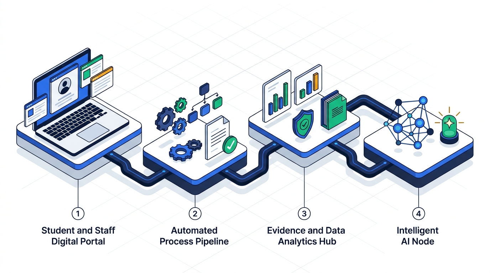
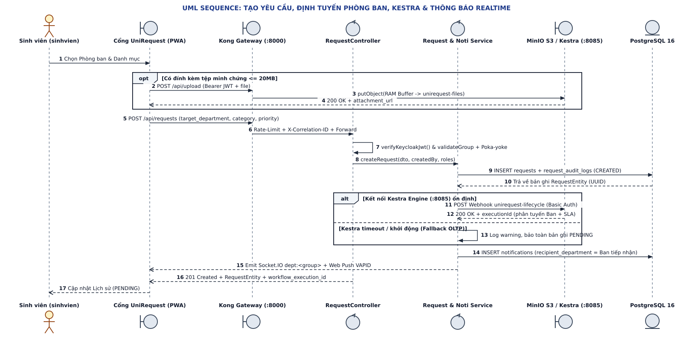
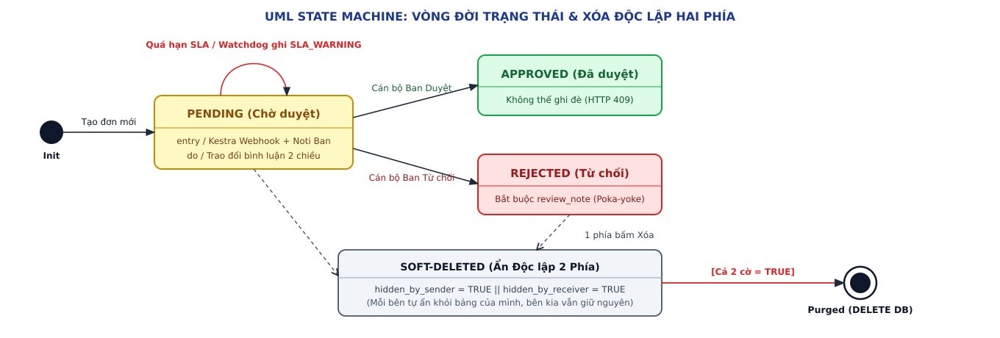
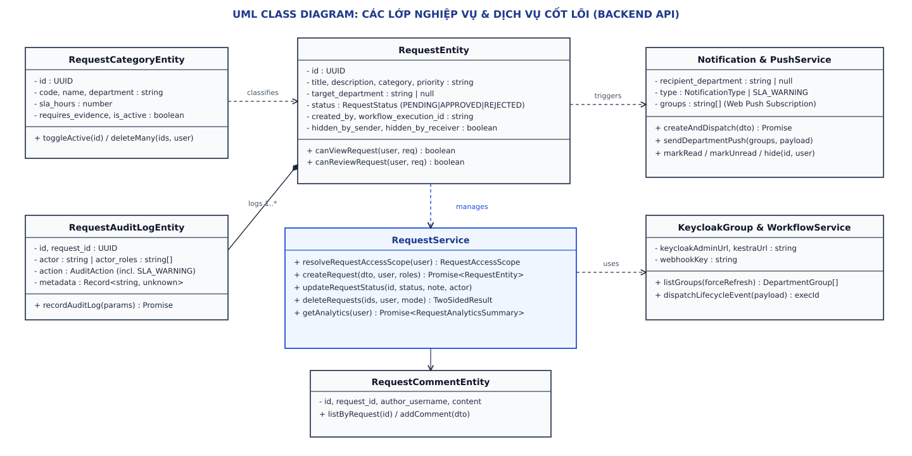
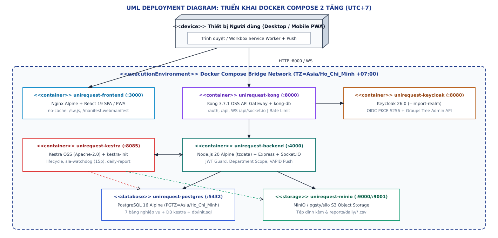
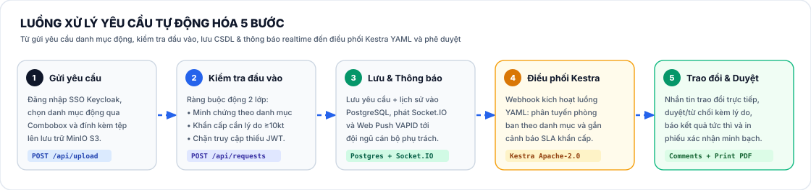

<p align="center">
  
</p>

<h1 align="center">UniRequest-OS</h1>

<p align="center">
  <strong>Nền tảng Nguồn mở Tiếp nhận &amp; Xử lý Yêu cầu Đại học (Two-Tier Open-Core)</strong><br />
  <em>Open-Source University Service Request &amp; Workflow Platform</em>
</p>

<p align="center">
  <a href="LICENSE"></a>
  
  
  
  
  
</p>


**UniRequest-OS** là nền tảng nguồn mở kiến trúc 2 tầng tách biệt giúp các trường đại học số hóa toàn bộ quy trình tiếp nhận yêu cầu từ sinh viên và giảng viên: định tuyến động theo cây phòng ban/nhóm Keycloak, quản lý danh mục độc lập theo từng ban, xóa yêu cầu hai phía không xung đột dữ liệu, lưu trữ tệp đính kèm S3, trao đổi trực tiếp theo thời gian thực, thông báo tách theo ban (In-App + Web Push), cài đặt ứng dụng PWA và tự động hóa 3 luồng quy trình trên Kestra Workflow Engine.

**University Digital Service Portal:** a decoupled two-tier open-source platform that digitizes university service requests with dynamic Keycloak-group department routing, department-scoped categories, non-destructive two-sided soft deletion, S3 attachment storage, realtime Socket.IO messaging and department-scoped notifications, installable PWA with Web Push (VAPID), and a 3-flow Kestra automation pack (realtime webhook routing, 15-minute SLA watchdog, and daily MinIO CSV reporting).

**English readers:** every section below includes an English summary. To spin up the full stack in one command, jump straight to [Quick start (English)](#-quick-start-english).

**Mục lục · Contents:** [Giới thiệu](#-giới-thiệu--introduction) · [Thách thức](#️-thách-thức--challenges) · [Giải pháp](#-giải-pháp--solution) · [Đối tượng](#-đối-tượng--users) · [Chức năng](#-chức-năng--features) · [Kiến trúc động](#️-kiến-trúc--architecture) · [Công nghệ](#️-công-nghệ--technology) · [Luồng nghiệp vụ](#-luồng-nghiệp-vụ--business-flows) · [Hướng phát triển](#-hướng-phát-triển--roadmap) · [Cài đặt từ máy sạch](#️-cài-đặt-từ-máy-sạch) · [Quick start](#-quick-start-english) · [Đóng góp](#-đóng-góp--contributing) · [Giấy phép](#-giấy-phép--license) · [CHANGELOG](#-changelog)

---

## 🧭 Giới thiệu · Introduction

Tại nhiều trường đại học, mỗi học kỳ có hàng nghìn yêu cầu từ sinh viên và giảng viên như xin giấy xác nhận sinh viên, đăng ký tín chỉ, phúc khảo bảng điểm, học phí/học bổng, mượn phòng học, hỗ trợ ký túc xá, hỗ trợ CNTT hay báo hỏng thiết bị phòng học. Phần lớn các thủ tục này vẫn đi qua đơn giấy, biểu mẫu rời rạc, nhóm chat hoặc email cá nhân - tạo thành các *"ốc đảo dữ liệu"*, khó truy vết ai đã xử lý và mất nhiều thời gian chờ đợi.

**UniRequest-OS** giải quyết bài toán này theo mô hình **Open-Core 2 tầng**: tách bạch **Tầng 1 (Nền tảng Dịch vụ Lõi Headless)** gồm 4 dịch vụ cốt lõi (Identity/SSO, API Gateway, Dữ liệu cấu trúc/phi cấu trúc, Workflow Engine) khỏi **Tầng 2 (Ứng dụng Cổng dịch vụ Đại học)** tối giản, dễ dùng và sẵn sàng triển khai thực tế.

At many universities, thousands of student and faculty requests - enrollment certificates, academic appeals, tuition support, room bookings, and facility repairs - are still handled through paper forms, scattered emails, and chat groups. **UniRequest-OS** separates a reusable **Tier 1 Headless Open-Core Platform** (SSO, API Gateway, PostgreSQL, MinIO S3, Kestra Workflow Engine) from a clean, production-ready **Tier 2 University Portal Application**.

---

## ⚠️ Thách thức · Challenges

- **Hồ sơ phân mảnh ("ốc đảo dữ liệu"):** Yêu cầu học vụ, xác nhận sinh viên, học bổng và báo hỏng cơ sở vật chất nằm rải rác ở nhiều phòng ban, không có nguồn sự thật duy nhất (*Single Source of Truth*).
- **Danh mục cứng nhắc, khó mở rộng:** Các phần mềm đóng thường cố định danh sách thủ tục trong mã nguồn, khiến nhà trường không thể chủ động thêm loại yêu cầu mới theo từng học kỳ.
- **Độ trễ phản hồi và thiếu trao đổi hai chiều:** Sinh viên phải liên tục tải lại trang để kiểm tra kết quả; cán bộ không có kênh nhắn trực tiếp để yêu cầu bổ sung giấy tờ trước khi quyết định.
- **Sai sót ngay từ đầu vào & thiếu minh bạch:** Gửi thiếu ảnh hiện trường khi báo hỏng hoặc chọn khẩn cấp không rõ lý do; không lưu lịch sử ai duyệt, duyệt lúc nào và vì sao bị từ chối.

*English:*
- **Fragmented data silos:** Requests live across disconnected channels with no single source of truth.
- **Rigid hardcoded forms:** Administrative offices cannot add or customize request types without developer intervention.
- **Delayed feedback & missing 2-way conversation:** Users must manually refresh to see status updates, and staff cannot ask clarifying questions inline.
- **Preventable input errors & lack of auditability:** Missing facility photos or unjustified urgent flags waste review time, with no immutable history.

---

## 💡 Giải pháp · Solution



- **Định tuyến động theo cây Group Keycloak (`GET /api/departments`):** Tự động đồng bộ cấu trúc phòng ban và nhóm con từ Keycloak Admin API (ví dụ `CTSV`, `KETOAN`, `Lớp/K11A1`) thay cho danh sách cố định. Sinh viên chọn đúng phòng ban tiếp nhận (`target_department`); cán bộ/giảng viên thuộc Group nào chỉ xem, lọc, nhận thông báo và xử lý yêu cầu thuộc Group đó hoặc Group con bên trong.
- **Danh mục yêu cầu động tách riêng theo từng Phòng ban:** Mỗi phòng ban tự tạo, chỉnh sửa, bật/tắt và xóa hàng loạt (qua Checkbox) các loại thủ tục thuộc phạm vi của ban mình trong `request_categories`, kèm thời hạn SLA và ràng buộc minh chứng. Form gửi yêu cầu tự lọc danh mục theo phòng ban đang chọn và hỗ trợ nhập loại tùy chỉnh (*"Yêu cầu khác"*).
- **Xóa yêu cầu độc lập hai phía (`hidden_by_sender` / `hidden_by_receiver`):** Hỗ trợ chọn nhiều bằng Checkbox để xóa gọn lịch sử/hàng đợi mà không gây mất dữ liệu phía đối diện - người nhận xóa không làm mất đơn của người gửi và ngược lại; bản ghi chỉ `DELETE` vĩnh viễn khỏi PostgreSQL khi cả hai phía đều đã xóa.
- **Realtime Socket.IO, Thông báo tách theo Ban & Web Push (VAPID):** Kết nối thời gian thực đi qua cổng **Kong Gateway** (`/api/socket.io`) xác thực bằng Keycloak JWT RS256. Thông báo gắn `recipient_department` và `push_subscriptions.groups` để bắn đúng chuông/thiết bị của Ban phụ trách, lưu trạng thái đọc/ẩn độc lập theo từng tài khoản (`notification_reads`) và đồng bộ đa tab tức thì.
- **Trao đổi trực tiếp, PWA cài đặt được & UI tối giản rõ nét:** Sinh viên và cán bộ trao đổi hai chiều trong chi tiết yêu cầu (`request_comments`); ứng dụng web đóng gói chuẩn **PWA (`vite-plugin-pwa` + Workbox)** an toàn (không cache `/auth` hay API bảo mật), giao diện lược bỏ mô tả rườm rà và dùng viền focus đỏ `3px` dễ nhận diện trên các ô nhập liệu.
- **Bộ 3 Workflow Tự động hóa Kestra (GitOps YAML · Apache-2.0):** Ngoài luồng Webhook realtime (`unirequest-lifecycle`), hệ thống trang bị thêm Watchdog giám sát SLA quá hạn mỗi 15 phút (`unirequest-sla-watchdog` gọi callback nội bộ bắn cảnh báo khẩn `SLA_WARNING`) và báo cáo CSV tổng hợp cuối ngày lưu thẳng lên MinIO (`unirequest-daily-report`).

*English:*
- **Dynamic Keycloak Group Tree Routing (`GET /api/departments`):** Syncs hierarchical groups and subgroups from Keycloak Admin API (`CTSV`, `KETOAN`, `Lớp/K11A1`, etc.) so students route requests to the exact department and staff only access their own group/subgroups.
- **Department-Scoped Dynamic Categories & Bulk Checkbox Actions:** Each department creates, filters, toggles, and bulk-deletes its own categories in `request_categories`, dynamically filtering the student request form by selected department.
- **Two-Sided Independent Soft Delete (`hidden_by_sender` / `hidden_by_receiver`):** Bulk checkbox deletion from either sender or receiver hides the record only for that side until both sides delete it, triggering automatic physical DB cleanup.
- **Department-Scoped Realtime Notifications, Inline Comments & Installable PWA:** Zero-Trust Socket.IO (`/api/socket.io`), per-user notification read states (`notification_reads`), department-targeted Web Push (VAPID), inline comments (`request_comments`), 3px red focus rings on inputs, and an offline-safe Workbox PWA.
- **3-Flow Kestra Automation Pack (GitOps YAML · Apache-2.0):** Includes realtime department/SLA webhook routing, a 15-minute PostgreSQL SLA watchdog calling back `/api/internal/kestra/sla-alert` (`SLA_WARNING`), and a daily 17:30 MinIO CSV reporting flow.

---

## 👥 Đối tượng · Users

| Đối tượng · *Who* | Mục đích sử dụng · *Uses it to* | Vai trò & Nhóm Keycloak · *Role / Group* |
| :--- | :--- | :--- |
| **Sinh viên** · *Students* | Đăng nhập một cửa, chọn phòng ban tiếp nhận & danh mục tương ứng, đính kèm ảnh/PDF, trao đổi trực tiếp, nhận thông báo realtime/Web Push, xóa lịch sử cá nhân và in phiếu xác nhận | `sinhvien` *(chỉ xem đơn của chính mình)* |
| **Cán bộ phòng ban** · *Administrative Staff* | Tiếp nhận, trao đổi, phê duyệt/từ chối, nhận cảnh báo SLA quá hạn và quản trị danh mục theo đúng Group/Group con được phân (hoặc toàn trường nếu không gắn Group) | `canbo` + Keycloak Groups (`KETOAN`, `CTSV`...) |
| **Giảng viên** · *Lecturers* | Tiếp nhận, trao đổi và phê duyệt các yêu cầu học vụ, quản trị danh mục trong phạm vi đơn vị/lớp phụ trách | `giangvien` + Keycloak Groups (`Lớp/K11A1`...) |
| **Quản trị hệ thống** · *System Admin* | Quản trị phân quyền/Group Keycloak, giám sát toàn trường, cấu hình danh mục & theo dõi luồng tự động hóa Kestra | `admin` *(phạm vi toàn trường `ALL`)* |

---

## 📱 Chức năng · Features

| Nhóm | Chức năng · *Feature* | Trạng thái (`v0.7.0`) |
| :---: | :--- | :--- |
| **Định danh & Nhóm** | **Đăng nhập tập trung SSO (Keycloak OIDC + PKCE S256) & Cây Group** | ✅ Không lưu mật khẩu trong DB; trích xuất `roles` + `groups` từ JWT; đồng bộ động cây Group qua `/api/departments` |
| **Định tuyến Phòng ban** | **Phân quyền 3 phạm vi (`ALL` / `DEPARTMENT` / `PERSONAL`)** | ✅ `admin` hoặc cán bộ không gắn Group xem toàn trường; cán bộ gắn Group (`KETOAN`, `Lớp/K11A1`...) chỉ xử lý đơn thuộc Group đó & Group con; `sinhvien` chỉ xem đơn của mình |
| **Giao diện & UX** | **Cổng dịch vụ tối giản (React 19 + Shadcn/UI + Radix)** | ✅ Logo 3D nền trong suốt, Sáng/Tối, viền focus đỏ `3px` trên input/textarea, chọn nhiều bằng Checkbox (icon) để xóa hàng loạt |
| **Xóa 2 phía** | **Ẩn/Xóa độc lập Người gửi - Người nhận (`hidden_by_sender/receiver`)** | ✅ Xóa ở tab *Lịch sử* không mất ở tab *Tiếp nhận* và ngược lại; tự động `DELETE` khỏi PostgreSQL khi cả 2 bên cùng xóa |
| **Realtime & Thông báo** | **Socket.IO qua Kong + Thông báo tách theo Ban & Web Push (VAPID)** | ✅ Thông báo & Push gắn `recipient_department` và `groups` đúng đơn vị tiếp nhận; trạng thái đọc/ẩn riêng từng người (`notification_reads`); đồng bộ đa tab |
| **Trao đổi** | **Bình luận trực tiếp trong chi tiết yêu cầu (`request_comments`)** | ✅ Trao đổi 2 chiều theo thời gian thực giữa người gửi và cán bộ phụ trách ngay trong hộp thoại chi tiết yêu cầu |
| **PWA** | **Ứng dụng web cài đặt được (`vite-plugin-pwa` + Workbox)** | ✅ Cài đặt lên màn hình chính Desktop/Mobile, bộ icon từ Logo 3D, cache App Shell an toàn (không cache `/auth` hay API bảo mật), thanh trạng thái Ngoại tuyến |
| **Danh mục động** | **Quản trị Danh mục theo từng Ban (`request_categories` + `/api/categories`)** | ✅ Từng Ban tự tạo/sửa/bật-tắt/xóa hàng loạt danh mục thuộc phạm vi mình; Combobox tự lọc theo phòng ban đang chọn và hỗ trợ *"Yêu cầu khác"* |
| **Tệp đính kèm** | **Lưu trữ tệp S3 không qua đĩa trung gian** | ✅ Tải trực tiếp qua RAM Buffer (`multer.memoryStorage`) lên MinIO `unirequest-files` (<= 20MB), xem trước ảnh trực tiếp |
| **Kiểm soát lỗi** | **Kiểm tra ràng buộc nghiệp vụ hai lớp (Frontend & API)** | ✅ Ràng buộc phòng ban hợp lệ, minh chứng động theo danh mục, lý do khẩn cấp, bắt buộc lý do từ chối và chặn ghi đè hồ sơ đã xử lý (`409`) |
| **Tự động hóa Kestra** | **Bộ 3 Workflow GitOps YAML (`unirequest.dxos`) + Callback SLA** | ✅ `unirequest-lifecycle` (Webhook realtime + DB), `unirequest-sla-watchdog` (15 phút quét quá hạn -> callback `/api/internal/kestra/sla-alert` ghi `SLA_WARNING`), `unirequest-daily-report` (17:30 xuất CSV -> MinIO) |
| **Báo cáo & Truy vết** | **Lịch sử xử lý bất biến, Biểu đồ 7 ngày & In phiếu xác nhận** | ✅ Bảng `request_audit_logs` (gồm `SLA_WARNING`), API `GET /api/requests/analytics` lọc theo phạm vi phòng ban, tỷ lệ hoàn tất & thời gian xử lý TB |
| **AI mở rộng** | **Phân loại & Trợ lý AI nội bộ (Ollama / RAG)** | 🗓️ Lộ trình `v1.0.0` - mở rộng qua Kestra AI Plugin mà không đổi kiến trúc lõi |

---

## 🗺️ Kiến trúc · Architecture

### Sơ đồ Kiến trúc Động 2 Tầng (Animated SVG)


Hệ thống tuân thủ nguyên lý **phân tách 2 tầng Open-Core**:

1. **Tầng 1 - Lõi Headless Open-Core (`docker-compose.yml`, `config/`):** Cung cấp 4 nhóm dịch vụ hạ tầng chạy ngầm:
   - **Identity / SSO:** `Keycloak 26.0` (tự nạp Realm `unirequest`, cấp JWT RS256 kèm `roles` & `groups`, đồng thời cấp dữ liệu cây Group động qua Keycloak Admin API).
   - **API Gateway (Zero-Trust Border):** `Kong 3.7.1 OSS` định tuyến `/auth` -> Keycloak (`strip_path=true`) và `/api` -> Backend (`strip_path=false`, hỗ trợ cả REST lẫn WebSocket Upgrade `/api/socket.io`), tự động kích hoạt `rate-limiting` (120 req/phút) và `correlation-id` (`X-Correlation-ID`) qua `kong-init`.
   - **Structured & Unstructured Data:** `PostgreSQL 16` (10 script migration idempotent trong `config/postgres/init/`, hỗ trợ `target_department`, `recipient_department`, `hidden_by_sender`/`hidden_by_receiver`, `request_categories`, `request_audit_logs`, `request_comments`, `notifications`, `notification_reads`, `push_subscriptions` và DB `kestra`) kết hợp `MinIO S3` (lưu tệp đính kèm và báo cáo CSV tự động tại `unirequest-files/reports/daily/`).
   - **Workflow Engine:** `Kestra OSS` (Apache-2.0), nạp biến môi trường nội mạng `ENV_*` và tự động đồng bộ toàn bộ 3 luồng YAML GitOps qua `kestra-init` ([kestra-setup.sh](scripts/kestra-setup.sh)):
     - [unirequest-lifecycle.yml](config/kestra/flows/unirequest-lifecycle.yml): Webhook realtime nhận payload tạo/cập nhật yêu cầu, phân tuyến động theo `target_department`, phân loại SLA (`URGENT`/`HIGH`/`NORMAL`) và kiểm tra hàng đợi `PENDING` trên PostgreSQL.
     - [unirequest-sla-watchdog.yml](config/kestra/flows/unirequest-sla-watchdog.yml): Lịch chạy mỗi 15 phút (`*/15 * * * *`, hỗ trợ tham số `testThresholdMinutes` khi chạy tay) quét đơn `PENDING` quá hạn, dùng `Loop` gọi callback `POST /api/internal/kestra/sla-alert` (`x-kestra-key`) để ghi audit `SLA_WARNING` (chống lặp 6 giờ) và đẩy cảnh báo khẩn về Portal.
     - [unirequest-daily-report.yml](config/kestra/flows/unirequest-daily-report.yml): Lịch chạy `17:30` hằng ngày (`30 17 * * *`, múi giờ `Asia/Ho_Chi_Minh`) chạy song song thống kê theo phòng ban & KPI, chuyển CSV (`IonToCsv`) và upload thẳng lên MinIO.
2. **Tầng 2 - Ứng dụng Nghiệp vụ (`apps/demo-app`, `apps/backend-api`):** Toàn bộ giao tiếp REST & Socket.IO đi qua cổng Kong `:8000`; Backend xác minh JWT RS256 từ Public Key của Keycloak, phân giải phạm vi phòng ban (`ALL` / `DEPARTMENT` / `PERSONAL`), ghi lịch sử xử lý, phát sự kiện realtime/Web Push theo đúng phòng ban và giao tiếp hai chiều với Kestra.

### Bộ Sơ đồ UML 2.x Chuẩn Kiến trúc (BCE Sequence, Use Case, State, Class & Deployment)

> Toàn bộ sơ đồ UML 2.x dưới đây tuân thủ ký hiệu chuẩn (Actor / Boundary / Control / Entity kèm `opt`, `alt`/`else` và đánh số thứ tự lời gọi `1..17` đồng bộ cả đầu trên và chân dưới lifeline):




<details>
<summary><strong>Xem thêm: Bộ sơ đồ UML Use Case, State Machine, Class, Deployment &amp; Mã Mermaid UML 2.x</strong></summary>

#### 1. UML Use Case Diagram


#### 2. UML State Machine Diagram (Vòng đời trạng thái &amp; Xóa độc lập 2 phía)


#### 3. UML Class Diagram (Các lớp nghiệp vụ &amp; dịch vụ Backend)


#### 4. UML Deployment Diagram (Docker Compose 2 tầng &amp; UTC+7)


#### 5. Mã nguồn Mermaid UML 2.x (Sequence với `activate`/`deactivate`, `opt`, `alt/else`)
```mermaid
sequenceDiagram
    autonumber
    actor SV as Sinh viên (sinhvien)
    participant FE as Boundary: UniRequest Portal (:3000)
    participant KONG as Boundary: Kong Gateway (:8000)
    participant CTRL as Control: RequestController
    participant SVC as Control: Request &amp; Noti Service
    participant EXT as Boundary: MinIO / Kestra (:8085)
    database PG as Entity: PostgreSQL 16

    SV->>+FE: 1. Chọn Phòng ban (/api/departments), Danh mục & nội dung
    opt Có tệp đính kèm (<= 20MB)
        FE->>+KONG: 2. POST /api/upload (Bearer JWT + file)
        KONG->>+EXT: 3. putObject(RAM Buffer -> unirequest-files)
        EXT-->>-FE: 4. 200 OK + attachment_url
        deactivate KONG
    end

    FE->>+KONG: 5. POST /api/requests (target_department, category, priority)
    KONG->>+CTRL: 6. Verify Rate-Limit + X-Correlation-ID + Forward JWT
    CTRL->>CTRL: 7. verifyKeycloakJwt() & validateGroup + Poka-yoke
    CTRL->>+SVC: 8. createRequest(dto, createdBy, roles)
    SVC->>+PG: 9. INSERT requests + request_audit_logs (CREATED)
    PG-->>-SVC: 10. Trả về RequestEntity (UUID)

    alt Kết nối Kestra Engine (:8085) ổn định
        SVC->>+EXT: 11. POST Webhook unirequest-lifecycle (Basic Auth)
        EXT-->>-SVC: 12. 200 OK + executionId (phân tuyến Ban + SLA)
    else Kestra timeout / khởi động (Fallback OLTP)
        SVC->>SVC: 13. Log warning, bảo toàn bản ghi PENDING trong PostgreSQL
    end

    SVC->>+PG: 14. INSERT notifications (recipient_department = Ban tiếp nhận)
    PG-->>-SVC: 15. OK
    SVC-->>FE: 16. Emit Socket.IO dept:<group> + Web Push VAPID
    deactivate SVC
    CTRL-->>-FE: 17. 201 Created + RequestEntity
    deactivate KONG
    FE-->>-SV: 18. Cập nhật Lịch sử &amp; hiển thị PENDING
```

</details>

---

## ⚙️ Công nghệ · Technology

Toàn bộ ngăn xếp công nghệ sử dụng **100% giấy phép nguồn mở chuẩn OSI (Free & Open Source Software)**, bao gồm **Kestra OSS (Apache-2.0)** cho tầng điều phối quy trình:

| Lớp chức năng · *Layer* | Công nghệ · *Technology* | Vai trò · *Role* | Giấy phép OSI · *License* |
| :--- | :--- | :--- | :--- |
| **SSO & RBAC** | Keycloak `26.0` | Định danh tập trung OIDC, PKCE S256, cấp JWT RS256 (`roles` + `groups`) & Admin Group Tree API | **Apache-2.0** |
| **API Gateway** | Kong Gateway `3.7.1` OSS | Định tuyến `/auth`, `/api` & `/api/socket.io`, Rate-Limiting, `X-Correlation-ID` | **Apache-2.0** |
| **Database** | PostgreSQL `16-alpine` | Dữ liệu `requests` (`target_department`, `hidden_by_*`), `request_categories`, `request_audit_logs`, `request_comments`, `notifications`, `push_subscriptions` | **PostgreSQL License** |
| **Object Storage** | MinIO S3 API | Lưu trữ ảnh/tài liệu đính kèm & báo cáo CSV ngày (`unirequest-files`) | **AGPL-3.0 / Apache-2.0** *(dịch vụ tách biệt)* |
| **Workflow Engine** | Kestra OSS (`kestra/kestra`) | Bộ 3 workflow GitOps YAML: Lifecycle Webhook, SLA Watchdog (15 phút) & Daily CSV Report (17:30) | **Apache-2.0** |
| **Backend & Realtime** | Node.js 20, Express, TypeScript, Socket.IO, `web-push` | JWT + Group Scope Middleware, `/api/departments`, Kestra Callback, Department Notifications & Analytics | **MIT** |
| **Frontend & PWA** | React 19, TypeScript, Vite 8, Tailwind v4, Shadcn/UI, `vite-plugin-pwa` | Giao diện Sáng/Tối, viền focus đỏ `3px`, xóa hàng loạt Checkbox, Notification Center, Comments, Workbox SW | **MIT** |
| **Web Server (SPA/PWA)** | Nginx `alpine` | Phục vụ bundle tĩnh gọn nhẹ, SPA fallback, `no-cache` cho `sw.js` & `manifest.webmanifest`, `/health` | **BSD-2-Clause** |
| **UniRequest-OS** | Toàn bộ mã nguồn & cấu hình | Nền tảng Cổng dịch vụ Yêu cầu Đại học | **Apache-2.0** ([LICENSE](LICENSE)) |

---

## 🔄 Luồng nghiệp vụ · Business flows



### 1. Luồng Sinh viên gửi yêu cầu & nhận phản hồi realtime
1. **Đăng nhập & Chọn Phòng ban tiếp nhận:** Sinh viên đăng nhập tài khoản trường, chọn **Phòng ban / Nhóm tiếp nhận** (`target_department` nạp động từ Keycloak Groups qua `/api/departments`), tìm loại yêu cầu thuộc ban đó từ danh mục động (hoặc nhập tên cụ thể khi chọn *"Yêu cầu khác"*), chọn mức ưu tiên và đính kèm tệp nếu cần.
2. **Kiểm tra đầu vào:** Hệ thống kiểm tra tự động phòng ban hợp lệ, minh chứng theo cấu hình danh mục hoặc lý do khẩn cấp.
3. **Lưu trữ, Điều phối & Thông báo tách theo Ban:** Lưu bản ghi `PENDING` vào PostgreSQL, kích hoạt Webhook [unirequest-lifecycle.yml](config/kestra/flows/unirequest-lifecycle.yml) trên Kestra và phát thông báo realtime (Socket.IO + Web Push) **chỉ tới đúng Ban phụ trách**. Sinh viên có thể xóa đơn khỏi *Lịch sử* cá nhân mà không ảnh hưởng tới hàng đợi của Phòng ban.

### 2. Luồng Cán bộ / Giảng viên xử lý theo Ban, SLA Watchdog & Báo cáo tự động
1. **Tiếp nhận, Trao đổi & Phê duyệt đúng phạm vi:** Cán bộ thuộc Group nào chỉ thấy đơn, thông báo và thống kê của Group đó (và Group con bên trong); trao đổi 2 chiều trong mục **Trao đổi**, sau đó bấm **Duyệt** hoặc **Từ chối** (bắt buộc nhập lý do) hoặc tick Checkbox để xóa các đơn đã xử lý khỏi hàng đợi mà không làm mất lịch sử của Sinh viên.
2. **Giám sát SLA & Báo cáo cuối ngày tự động (Kestra):** Mỗi 15 phút, [unirequest-sla-watchdog.yml](config/kestra/flows/unirequest-sla-watchdog.yml) quét đơn `PENDING` quá hạn (2h/8h/24h hoặc theo `testThresholdMinutes` khi test) và gọi callback `POST /api/internal/kestra/sla-alert` để ghi `SLA_WARNING` và bắn thông báo đỏ về chuông Ban phụ trách. Lúc `17:30` mỗi ngày, [unirequest-daily-report.yml](config/kestra/flows/unirequest-daily-report.yml) tự xuất CSV lên MinIO `unirequest-files/reports/daily/`.
3. **Quản trị danh mục riêng theo từng Ban:** Tại mục **Danh mục**, mỗi Ban tự tạo, chỉnh sửa, bật/tắt hoặc chọn nhiều Checkbox để xóa các loại yêu cầu thuộc ban mình, đặt thời hạn xử lý (SLA) và yêu cầu minh chứng.
4. **Thống kê & In phiếu xác nhận:** Biểu đồ xu hướng 7 ngày và phân bổ theo danh mục tự động cập nhật theo đúng phạm vi quyền; sinh viên và cán bộ đều có thể **In phiếu xác nhận** kèm lịch sử xử lý (bao gồm dấu mốc `SLA_WARNING`).

*English summary:* Students sign in via Keycloak PKCE SSO, select a live Keycloak-synced target department (`GET /api/departments`), pick a department-scoped category (or enter a custom label), upload attachments to MinIO, and trigger Kestra webhook routing plus department-targeted realtime/Web Push notifications. Staff only see requests, analytics, and notifications within their Keycloak group/subgroups, manage department-specific categories with bulk checkbox delete, hide processed rows independently (`hidden_by_sender` / `hidden_by_receiver`), receive automated 15-minute `SLA_WARNING` alerts from Kestra Watchdog, and archive daily 17:30 CSV summaries in MinIO.

---

## 🚀 Hướng phát triển · Roadmap

- ✅ **v0.1.0 - Lõi hạ tầng & API cốt lõi:** Docker Compose (PostgreSQL, Keycloak, Kong, MinIO), Backend Express TypeScript xác thực JWT RS256, RBAC và upload RAM buffer lên MinIO.
- ✅ **v0.2.0 - Portal Shadcn/UI & Dockerize:** Frontend React 19 + TypeScript strict + Shadcn/UI (Radix UI), chế độ Sáng/Tối, đóng gói Nginx multi-stage (`:3000`).
- ✅ **v0.3.0 - Tự động hóa 1-lệnh & Kestra Workflow Engine:** `LICENSE` Apache-2.0, `.env.example`, tự động nạp Keycloak `realm-export.json`, `kong-init`, **Kestra OSS (Apache-2.0)** + `kestra-init` + luồng GitOps YAML.
- ✅ **v0.4.0 - Quy trình nghiệp vụ, Lịch sử xử lý & DevOps:** `request_audit_logs`, API `/analytics` & `/:id`, `Makefile`, Windows WSL2 Launcher và GitHub Actions CI.
- ✅ **v0.5.0 - Thiết kế tối giản, Logo 3D nền trong suốt & Danh mục động:** Tách nền Logo 3D (`logo-3d.png`), phân vai ngữ cảnh cổng (*Sinh viên / Giảng viên / Cán bộ / Quản trị*), bảng `request_categories` + `/api/categories` CRUD + Combobox tìm kiếm, tách biệt Dashboard Sinh viên và Cán bộ với biểu đồ 7 ngày.
- ✅ **v0.6.0 - Realtime Socket.IO, Thông báo đa kênh, Bình luận & PWA:** Tích hợp Socket.IO xác thực JWT qua Kong (`/api/socket.io`), Trung tâm Thông báo (đọc/chưa đọc/ẩn theo từng tài khoản, tự đọc khi mở yêu cầu, đồng bộ đa tab), Bình luận trực tiếp (`request_comments`), PWA cài đặt được (`vite-plugin-pwa` + Workbox) và Web Push VAPID.
- ✅ **v0.7.0 - Định tuyến Phòng ban theo Keycloak Groups, Xóa độc lập 2 phía & Kestra 3-Flow Automation Pack:** Đồng bộ cây Group động từ Keycloak (`/api/departments`), phân quyền 3 phạm vi (`ALL`/`DEPARTMENT`/`PERSONAL`), danh mục và thông báo tách riêng theo Ban kèm xóa hàng loạt bằng Checkbox, cơ chế soft-delete hai phía (`hidden_by_sender`/`hidden_by_receiver`) + tự dọn DB, viền focus đỏ `3px` trên ô nhập liệu, và nâng cấp Kestra lên 3 workflows (`unirequest-lifecycle`, `unirequest-sla-watchdog`, `unirequest-daily-report`) kèm callback `/api/internal/kestra/sla-alert`.
- 🗓️ **v1.0.0 - Mở rộng AI & Triển khai Production:**
  - Tích hợp gợi ý phân loại yêu cầu tự động bằng AI nội bộ (Ollama / RAG qua Kestra AI Plugin).
  - Hỗ trợ triển khai HTTPS chuẩn sản xuất với Reverse Proxy / Let's Encrypt.

---

## 🛠️ Cài đặt từ máy sạch

> **English:** See [Quick start (English)](#-quick-start-english) right below.

### Yêu cầu hệ thống
| Thành phần | Yêu cầu tối thiểu |
| :--- | :--- |
| Hệ điều hành | Linux (Ubuntu 22.04/24.04), macOS hoặc Windows qua **WSL 2** |
| Docker | Docker Engine 24+ / Docker Desktop và **Docker Compose v2.20+** |
| Tài nguyên | RAM ≥ 4 GB (khuyến nghị 6 GB để chạy mượt Keycloak + Kestra), ổ trống ≥ 8 GB |
| Cổng trống | `3000` (Frontend/PWA), `4000` (Backend + Socket.IO), `5432` (PostgreSQL), `8000`-`8001` (Kong), `8080` (Keycloak), `8085` (Kestra), `9000`-`9001` (MinIO) |

### Khởi chạy toàn hệ thống bằng 1 lệnh
```bash
git clone <url-kho-ma-nguon-unirequest-os>
cd UniRequest-OS
make build
```

> Hoặc dùng trực tiếp Docker Compose: `cp .env.example .env && docker compose up -d --build`. Trên Windows 10/11 (WSL2), bạn có thể bấm đúp vào [`scripts/windows/Start_UniRequest.bat`](scripts/windows/Start_UniRequest.bat) (xem hướng dẫn tại [`scripts/windows/README.md`](scripts/windows/README.md)).

Đợi khoảng 20-40 giây để Keycloak nạp Realm `unirequest`, `kong-init` cấu hình tuyến `/auth` & `/api`, và `kestra-init` đồng bộ luồng YAML. Sau đó chạy kiểm thử tích hợp tự động:

```bash
make test
```

### Danh sách cổng dịch vụ
| Dịch vụ | Địa chỉ | Ghi chú |
| :--- | :--- | :--- |
| **UniRequest Portal (Frontend & PWA)** | http://localhost:3000 | Cổng Sinh viên, Giảng viên & Cán bộ |
| **Kong API Gateway (Proxy & WS)** | http://localhost:8000 | Điểm vào tập trung (`/auth`, `/api`, `/api/socket.io`) |
| **Kestra Workflow Engine UI** | http://localhost:8085 | `admin@unirequest.edu.vn` / `KestraAdmin2026!` |
| **Keycloak Admin Console** | http://localhost:8080 | Tài khoản đặt trong `.env` (`KC_ADMIN_*`) |
| **MinIO Console** | http://localhost:9001 | Tài khoản đặt trong `.env` (`MINIO_ROOT_*`) |
| **Backend Health Check** | http://localhost:8000/api/health | Báo trạng thái `database`, `minio`, `workflow` |

### Tài khoản mẫu (tự động nạp từ `config/keycloak/realm-export.json`)
| Tài khoản | Mật khẩu | Vai trò & Nhóm mặc định | Quyền hạn |
| :--- | :---: | :--- | :--- |
| `sinhvien` | `Admin@123` | `sinhvien` · `/Lớp/K11A1` | Tạo yêu cầu, chọn phòng ban tiếp nhận, đính kèm tệp, trao đổi, nhận thông báo & in phiếu cá nhân |
| `canbo` | `123456` | `canbo` · `/CTSV` | Xem, trao đổi & phê duyệt yêu cầu thuộc Ban `CTSV`, quản lý danh mục `CTSV`, xem thống kê |
| `giangvien` | `123456` | `giangvien` · `/KETOAN` | Xem, trao đổi & phê duyệt yêu cầu thuộc Ban `KETOAN`, quản lý danh mục `KETOAN` |

> **Quản trị hệ thống (`admin`):** Để đảm bảo bảo mật, hệ thống **không nạp sẵn tài khoản `admin` mật khẩu mặc định** trong realm ứng dụng. Việc quản trị người dùng, cấp/thu hồi vai trò `admin` và cấu hình SSO được thực hiện duy nhất qua **Keycloak Admin Console** (`http://localhost:8080`) bằng tài khoản `KC_ADMIN_USER` / `KC_ADMIN_PASSWORD` đặt trong `.env`.

### Kiểm tra nhanh API, PWA & Realtime qua Kong Gateway
```bash
# 1. Kiểm tra sức khỏe đồng bộ 3 dịch vụ lõi (database, minio, workflow)
curl -s http://localhost:8000/api/health

# 2. Kiểm tra Zero-Trust JWT Guard (thiếu token phải trả về HTTP 401)
curl -s -o /dev/null -w "requests: HTTP %{http_code}\n" http://localhost:8000/api/requests
curl -s -o /dev/null -w "departments: HTTP %{http_code}\n" http://localhost:8000/api/departments
curl -s -o /dev/null -w "categories: HTTP %{http_code}\n" http://localhost:8000/api/categories
curl -s -o /dev/null -w "notifications: HTTP %{http_code}\n" http://localhost:8000/api/notifications

# 3. Kiểm tra PWA Manifest, Service Worker & Socket.IO Gateway qua Kong
curl -s http://localhost:3000/manifest.webmanifest
curl -s -o /dev/null -w "sw.js: HTTP %{http_code}\n" http://localhost:3000/sw.js
curl -s "http://localhost:8000/api/socket.io/?EIO=4&transport=polling"

# 4. Kiểm tra và thử nhanh Bộ 3 Kestra Workflows (:8085)
# - Truy cập http://localhost:8085 -> Flows -> namespace unirequest.dxos
# - Chạy thử unirequest-sla-watchdog với input testThresholdMinutes = 1 để test cảnh báo SLA_WARNING
# - Chạy thử unirequest-daily-report rồi mở MinIO Console (http://localhost:9001 -> unirequest-files/reports/daily/)
```

---

## 🚀 Quick start (English)

**Prerequisites:** Docker Engine 24+ (with Docker Compose v2.20+), ≥ 4 GB RAM (6 GB recommended), and free ports `3000`, `4000`, `5432`, `8000`, `8001`, `8080`, `8085`, `9000`, `9001`.

```bash
cp .env.example .env
make build
# Wait ~30s for Keycloak realm auto-import, kong-init, and kestra-init
make test
```

- Open the **UniRequest Portal (PWA)**: http://localhost:3000 (sign in with `sinhvien` / `Admin@123`, `giangvien` / `123456`, or `canbo` / `123456`; system administration uses the Keycloak Admin Console at http://localhost:8080 with `KC_ADMIN_*` from `.env`).
- Open the **Kestra Workflow UI**: http://localhost:8085 (`admin@unirequest.edu.vn` / `KestraAdmin2026!`) to inspect and run the 3 GitOps YAML workflows under namespace `unirequest.dxos` (`unirequest-lifecycle`, `unirequest-sla-watchdog`, `unirequest-daily-report`).
- Verify all core services via Kong: `curl -s http://localhost:8000/api/health`.

---

## 🤝 Đóng góp · Contributing

Mọi đóng góp về tính năng, quy trình Kestra YAML, bản dịch hoặc tài liệu đều được chào đón:

1. Fork kho mã nguồn và tạo nhánh mới (`feat/...` hoặc `fix/...`).
2. Kiểm tra chất lượng mã nguồn trước khi mở Pull Request:
   - Toàn bộ Frontend + Backend + Docker config: `make lint`
   - Hệ thống tích hợp E2E: `make test`
3. Không commit tệp `.env` hoặc dữ liệu volume cục bộ (`config/*/data/`).

## 🐛 Báo lỗi · Reporting bugs

Nếu phát hiện lỗi trong quá trình dựng Docker hoặc vận hành, vui lòng mở **GitHub Issue** kèm phiên bản Docker/HĐH, bước tái hiện lỗi, đầu ra của `make test` và log container liên quan (`make logs SERVICE=<tên>`).

---

## 📄 Giấy phép · License

Mã nguồn **UniRequest-OS** được phát hành theo giấy phép **[Apache License 2.0](LICENSE)**.

**Lý do chọn Apache-2.0:** Giấy phép nguồn mở chuẩn OSI cho phép các trường đại học, tổ chức giáo dục và cộng đồng tự do sử dụng, tùy biến, triển khai nội bộ mà không gặp rào cản copyleft chặt; đồng thời điều khoản cấp quyền sáng chế (*patent grant*) và yêu cầu ghi nhận nguồn rõ ràng giúp đảm bảo an toàn pháp lý khi đưa vào vận hành thực tế.

*The source code is licensed under [Apache License 2.0](LICENSE). Every core component uses an OSI-approved open-source license, including Kestra OSS (Apache-2.0) for workflow orchestration.*

---

## 📝 CHANGELOG

Quản lý phiên bản theo [SemVer](https://semver.org/):

- **`v0.7.0` (21/11/2026):**
  - **Định tuyến & Phân quyền theo Keycloak Groups:** Thêm `target_department` (`08-department-routing.sql`), API `GET /api/departments` đồng bộ đệ quy toàn bộ Group & Group con từ Keycloak Admin API, lọc quyền 3 tầng (`ALL` / `DEPARTMENT` / `PERSONAL`), và hỗ trợ thông báo + Web Push tách riêng theo từng Ban (`09-department-notifications.sql`).
  - **Danh mục theo Phòng ban & Xóa độc lập 2 phía:** Mỗi Ban quản trị độc lập danh mục yêu cầu của mình kèm xóa hàng loạt bằng Checkbox (`DELETE /api/categories`); bổ sung soft-delete hai phía (`10-independent-request-hide.sql`: `hidden_by_sender`, `hidden_by_receiver`) để xóa bên người gửi không làm mất bên người nhận (và ngược lại) cho tới khi cả 2 cùng xóa; tối giản mô tả UI và đổi viền focus ô nhập liệu sang màu đỏ `3px`.
  - **Bộ Kestra Automation Pack (3 Workflows hoàn chỉnh):** Nâng cấp `docker-compose.yml` (`ENV_*` env vars) & `scripts/kestra-setup.sh` (đồng bộ tất cả `*.yml` trong `config/kestra/flows/`), nâng cấp `unirequest-lifecycle` (phân tuyến động & truy vấn hàng đợi PostgreSQL), bổ sung `unirequest-sla-watchdog` (cron 15 phút + `testThresholdMinutes` gọi `POST /api/internal/kestra/sla-alert` ghi audit `SLA_WARNING` & đẩy cảnh báo khẩn), và `unirequest-daily-report` (cron `17:30` xuất báo cáo CSV tổng hợp lưu lên MinIO `unirequest-files/reports/daily/`).
- **`v0.6.0` (18/11/2026):** Tích hợp **PWA cài đặt được** (`vite-plugin-pwa` + Workbox App Shell + bộ icon từ Logo 3D + Offline Banner an toàn), **Bình luận trực tiếp trong yêu cầu** (`request_comments`), **Realtime Socket.IO** xác thực Keycloak JWT RS256 qua Kong Gateway (`/api/socket.io`), **Trung tâm Thông báo In-App** (đọc/chưa đọc/ẩn riêng từng người dùng qua `notification_reads`, tự động đánh dấu đã đọc khi mở yêu cầu, đồng bộ đa tab), **Web Push Notification** bằng VAPID (`push_subscriptions`), hỗ trợ `PATCH` CORS đầy đủ và bộ lọc *Tất cả / Đang bật / Đang ẩn* cho quản trị Danh mục.
- **`v0.5.0` (18/11/2026):** Thiết kế lại giao diện tối giản chuẩn triển khai thực tế - tích hợp Logo 3D nền trong suốt (`logo-3d.png`), tiêu đề & điều hướng tự thích ứng theo đúng vai trò (`Sinh viên`, `Giảng viên`, `Cán bộ`, `Quản trị viên`), hệ thống **Danh mục yêu cầu động** (`request_categories` + `/api/categories` CRUD + Combobox tìm kiếm + tùy chọn loại yêu cầu tự nhập), tách biệt Dashboard Sinh viên và Cán bộ với biểu đồ xu hướng 7 ngày & phân bổ theo danh mục, loại bỏ toàn bộ thuật ngữ kỹ thuật nội bộ khỏi giao diện người dùng cuối.
- **`v0.4.0` (18/11/2026):** Bổ sung bảng bất biến `request_audit_logs`, API `/api/requests/:id` & `/api/requests/analytics`, giao diện lịch sử xử lý, in phiếu xác nhận, `Makefile`, Windows Launcher và GitHub Actions CI.
- **`v0.3.0` (18/11/2026):** Bổ sung giấy phép `Apache-2.0`, `.env.example`, tự động nạp Keycloak `realm-export.json`, tự động cấu hình Kong (`kong-init`), và tích hợp **Kestra Workflow Engine (Apache-2.0)** với luồng GitOps YAML.
- **`v0.2.0` (18/11/2026):** Tái cấu trúc hoàn toàn Frontend sang React 19 + TypeScript strict + **Shadcn/UI (Radix UI)** + Tailwind v4, chế độ Sáng/Tối, đóng gói Nginx multi-stage (`:3000`).
- **`v0.1.0` (17/11/2026):** Khởi tạo nền tảng Docker Compose (PostgreSQL, Keycloak, Kong, MinIO) và Backend Express TypeScript xác thực JWT RS256, RBAC, tải tệp MinIO qua RAM Buffer.
