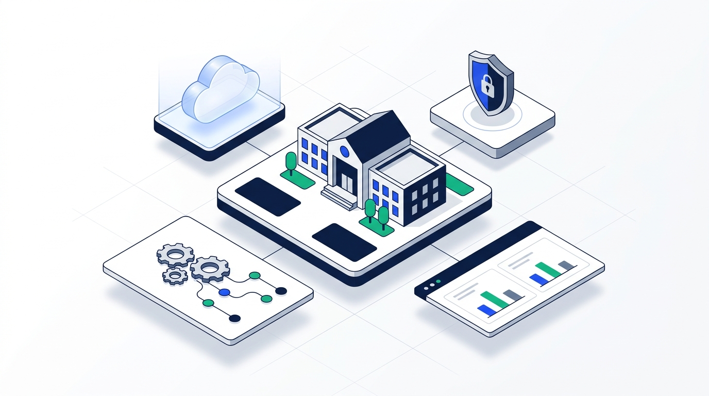
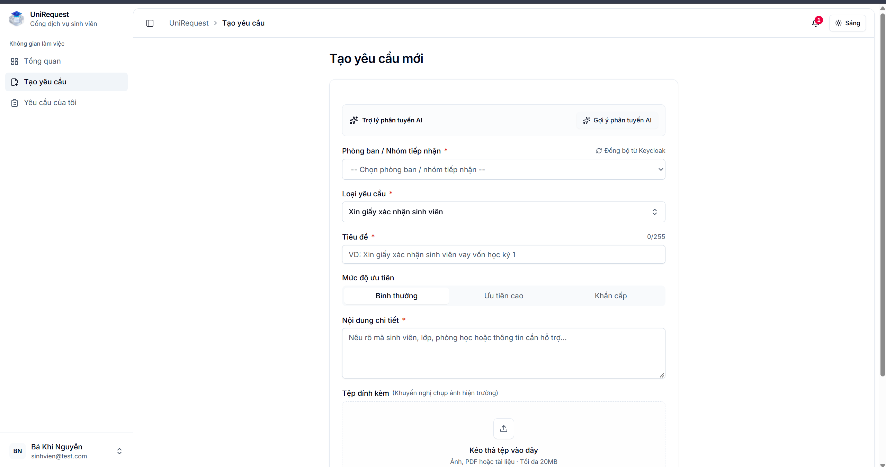

<p align="center">
  
</p>



# UniRequest-OS: Nền tảng Quản lý Yêu cầu Đại học (Student Request Management)

> Đồ án nghiên cứu và xây dựng nền tảng tiếp nhận, phân loại tự động và xử lý yêu cầu sinh viên tập trung cho trường đại học trên nền tảng phần mềm nguồn mở.

[](LICENSE)
[](https://olp.vn)
[](docker-compose.yml)
[](apps/demo-app/package.json)
[](apps/backend-api/package.json)
[](config/keycloak/realm-export.json)
[](config/kestra/flows)

---

## 1. Bài toán thực tế tại trường đại học & Giải pháp của nhóm

Tại nhiều trường đại học, mỗi học kỳ phát sinh hàng nghìn yêu cầu từ sinh viên và giảng viên như xin giấy xác nhận, gia hạn học phí, phúc khảo bảng điểm hay báo hỏng thiết bị phòng học. Khi tiếp nhận rời rạc qua đơn giấy, email hoặc tin nhắn nhóm, dữ liệu bị phân tán giữa các phòng ban, sinh viên không biết đơn của mình đang ở bước nào, còn cán bộ phải tổng hợp thủ công rất tốn công sức.

Nhóm xây dựng **UniRequest-OS: Nền tảng Quản lý Yêu cầu Đại học (Student Request Management)** theo mô hình **kiến trúc 3 tầng nguồn mở (DX-OS Open-Core)**: tách riêng phần hạ tầng dùng chung (`Keycloak`, `Kong`, `Kestra`, `PostgreSQL`, `MinIO`) khỏi ứng dụng Cổng Quản lý Yêu cầu Đại học (`React 19 PWA` + `Node.js/Express`). Nhờ đó, nhà trường vừa giải quyết được bài toán tiếp nhận và xử lý yêu cầu tập trung, vừa có sẵn nền tảng đăng nhập một lần (SSO), lưu trữ file và điều phối quy trình để phát triển thêm các phần mềm khác trong trường.

### Ai dùng - Dùng cái gì - Dùng như thế nào?

| Ai dùng? (Nhóm người dùng) | Dùng cái gì? (Phân hệ trên hệ thống) | Dùng như thế nào? (Thao tác thực tế) |
| :--- | :--- | :--- |
| **Sinh viên** (`sinhvien`) | **Cổng Sinh viên** (`React 19 PWA` trên máy tính và điện thoại) | Đăng nhập SSO → Nhập tiêu đề và bấm **Gợi ý phân tuyến AI `[I]`** để hệ thống tự chọn Phòng ban, Danh mục và Độ ưu tiên → Đính kèm file minh chứng (được kiểm tra chữ ký file thật `Magic Bytes` trong bộ nhớ trước khi lưu lên MinIO để chặn file thực thi đổi đuôi) → Theo dõi tiến độ xử lý, trao đổi bình luận 2 chiều và in phiếu xác nhận. |
| **Cán bộ / Giảng viên** (`canbo`, `giangvien`) | **Cổng Điều hành Phòng ban** (`CTSV`, `KETOAN`, `DAOTAO`...) | Nhận thông báo trực tiếp qua Socket.IO & Web Push VAPID theo đúng phòng ban phụ trách → Xem tóm tắt yêu cầu từ AI & kiểm tra lịch sử xử lý kèm mã băm `SHA-256` → Phê duyệt hoặc từ chối đơn, tự thêm/sửa danh mục thủ tục của phòng ban mình. |
| **Quản trị viên & Nhà trường** (`admin`) | **Keycloak Console, Kestra UI & Bảng thống kê `[D]`** | Thêm/sửa cơ cấu phòng ban trên Keycloak (giao diện cổng tự động cập nhật mà không cần sửa code), theo dõi 3 quy trình tự động trên Kestra (`unirequest.dxos`), xem biểu đồ thống kê 7 ngày (`+07:00`) và tải báo cáo CSV tổng hợp trên MinIO. |

---

## 2. Hướng dẫn chạy nhanh (Quick Start)

- **Yêu cầu môi trường:** Docker Engine `24.0+`, Docker Compose `v2.20+`, GNU Make `4.0+`, RAM `>= 4 GB` *(khuyến nghị `6 GB`; mức tiêu thụ đo thực tế bằng `docker stats` sau tối ưu đạt `~2.17 GiB` trên 8 container, giảm từ `3.28 GiB`)*.

```bash
git clone https://github.com/vothuong1706/UniRequest-OS.git
cd UniRequest-OS
make build
# Hệ thống tự nạp dữ liệu mẫu khi DB trống (hoặc chạy bất kỳ lúc nào: make seed)
# Đợi các dịch vụ Keycloak, Kong và Kestra khởi tạo xong cấu hình, sau đó chạy kiểm thử:
make unit-test && make test
```

> Trên Windows WSL2, có thể chạy trực tiếp tệp [`scripts/windows/Start_UniRequest.bat`](scripts/windows/Start_UniRequest.bat). Khi cần mở đường dẫn HTTPS công khai để dùng thử trên điện thoại, chạy `bash scripts/internet-demo.sh`.

### Tài khoản dùng thử (`config/keycloak/realm-export.json`)

| Tài khoản | Mật khẩu | Vai trò | Nhóm trên Keycloak | Phạm vi truy cập dữ liệu |
| :--- | :---: | :--- | :--- | :--- |
| `sinhvien` | `Admin@123` | `sinhvien` | `/Lớp/K11A1` | Chỉ xem và quản lý các yêu cầu do chính mình gửi |
| `sinhvien2` | `1234567` | `sinhvien` | `/Lớp/k11A2` | Tách biệt hoàn toàn dữ liệu với tài khoản `sinhvien` |
| `canbo` | `123456` | `canbo` | `/CTSV` | Tiếp nhận, phản hồi và duyệt yêu cầu gửi về Ban `CTSV` |
| `giangvien` | `123456` | `giangvien` | `/KETOAN` | Tiếp nhận, phản hồi và duyệt yêu cầu gửi về Ban `KETOAN` |
| *Admin hệ thống* | *Khai báo trong `.env`* | `admin` | Keycloak Console | Quản trị toàn hệ thống qua Keycloak Console |

### Địa chỉ truy cập các dịch vụ

| Dịch vụ | Địa chỉ truy cập | Ghi chú |
| :--- | :--- | :--- |
| **UniRequest Portal (Giao diện chính)** | <http://localhost:3000> | Cổng giao diện cho người dùng (Nginx tự chuyển tiếp `/api` và `/auth`) |
| **Kestra Workflow Engine UI** | <http://localhost:8085> | `KESTRA_BASIC_AUTH_USER` / `KESTRA_BASIC_AUTH_PASSWORD` trong `.env` |
| **Keycloak Admin Console** | <http://localhost:8080> | `KC_ADMIN_USER` / `KC_ADMIN_PASSWORD` trong `.env` |
| **MinIO S3 Console** | <http://localhost:9001> | `MINIO_ROOT_USER` / `MINIO_ROOT_PASSWORD` trong `.env` |
| **Kong API Gateway (Health Check)** | <http://localhost:8000/api/health> | Kong chỉ chuyển tiếp `/api/*` và `/auth/*` *(đường dẫn gốc `/` không mở giao diện)* |

---

## 3. Cấu trúc hệ thống & Lựa chọn công nghệ nguồn mở

Hệ thống được nhóm chia thành **3 tầng rõ ràng**:

- **Tầng 1 - Hạ tầng dịch vụ lõi (Headless Core):** Gồm `Keycloak 26.0` (đăng nhập SSO và quản lý cây phòng ban), `Kong Gateway` (cổng API kiểm tra giới hạn truy cập Rate-Limit và gắn mã truy vết `X-Correlation-ID`), `Kestra OSS` (điều phối quy trình tự động bằng YAML), `PostgreSQL 16` (lưu trữ dữ liệu và lịch sử xử lý) cùng `MinIO S3` (lưu trữ file đính kèm và báo cáo CSV).
- **Tầng 2 - Các module nghiệp vụ dùng chung `H-P-D-I`:** Cung cấp các dịch vụ xử lý phân quyền theo nhóm người dùng `[H]`, định tuyến quy trình và danh mục `[P]`, kiểm tra file cùng lịch sử dữ liệu `[D]`, và gợi ý phân loại bằng AI `[I]`.
- **Tầng 3 - Ứng dụng Cổng Quản lý Yêu cầu Đại học (UniRequest Portal):** Giao diện `React 19 PWA` kết hợp `Express REST API`, kết nối đồng nhất qua Nginx Same-Origin (`:3000`) và cổng Kong (`:8000`).

[](docs/images/architecture-animated.svg)

> Xem thêm: [Hướng dẫn đọc tài liệu](docs/README.md) · [Hồ sơ dự thi OLP PMNM 2026](docs/du-thi/README.md) · [Quá trình nghiên cứu & kiểm thử 7 bước SDLC](docs/research/README.md) · [Thiết kế kiến trúc & Cơ sở dữ liệu](docs/architecture.md) · [Bộ sơ đồ UML 2.x](docs/uml.md) · [Hướng dẫn vận hành & kết quả kiểm thử](docs/operations.md) · [Hỏi - Đáp kỹ thuật](docs/hoi-dap-hoi-dong.md).

| Nhóm chức năng | Công nghệ sử dụng | Giấy phép OSI | Vai trò trong dự án |
| :--- | :--- | :---: | :--- |
| Đăng nhập & Phân nhóm `[H]` | **Keycloak** `26.0` | `Apache-2.0` | Xác thực OIDC PKCE `S256`, cấp token JWT `RS256`, quản lý cây Group phòng ban |
| Cổng API & Reverse Proxy | **Kong OSS** `3.7.1` + Nginx + Caddy | `Apache-2.0`, `BSD` | Chuyển tiếp `/api`, `/auth`, Socket.IO, giới hạn tần suất gọi API & hỗ trợ HTTPS |
| Điều phối quy trình `[P]` | **Kestra OSS** `v2.0.11` (`unirequest.dxos`) | **`Apache-2.0`** | Chạy 3 quy trình YAML: tiếp nhận đơn mới, quét cảnh báo đơn quá hạn SLA và xuất báo cáo CSV |
| Cơ sở dữ liệu `[D]` | **PostgreSQL** `16-alpine` | `PostgreSQL` | Lưu 7 bảng nghiệp vụ, hỗ trợ ẩn đơn độc lập 2 phía và nối mã băm `SHA-256` cho lịch sử xử lý |
| Lưu trữ file `[D]` | **MinIO S3** (`pgsty/silo:RELEASE.2026-11-12T00-00-00Z`) | `AGPL-3.0-or-later` | Lưu trữ file minh chứng ở bucket Private kèm chữ ký HMAC ngắn hạn *(chạy container tách biệt qua S3 HTTP nên không xung đột `Apache-2.0`)* |
| Hỗ trợ phân loại `[I]` | **Ollama** *(tùy chọn)* + Bộ phân tích tiếng Việt | `MIT` | Gợi ý phòng ban, danh mục, mức ưu tiên từ nội dung tiếng Việt và tóm tắt đơn cho cán bộ |
| Giao diện & Máy chủ API | **React 19 PWA**, Node.js `20`, Express | `MIT` | Giao diện Sáng/Tối, hỗ trợ cài đặt PWA, cập nhật trực tiếp qua Socket.IO & Web Push VAPID |

### Cách nhóm áp dụng các nguyên tắc thiết kế nguồn mở

| Nguyên tắc thiết kế | Cách nhóm thực hiện trong dự án | Tệp mã nguồn & cấu hình |
| :--- | :--- | :--- |
| **1. Kết nối các phần mềm nguồn mở chuẩn** | Sử dụng image chính thức của `Keycloak`, `Kong`, `Kestra`, `PostgreSQL`, `MinIO` và cấu hình qua script tự động. | [`docker-compose.yml`](docker-compose.yml), [`kong-setup.sh`](kong-setup.sh), [`config/kestra/flows/`](config/kestra/flows) |
| **2. Tách phần hạ tầng lõi khỏi giao diện** | Tầng hạ tầng không gắn chặt vào giao diện; ứng dụng Cổng Quản lý Yêu cầu giao tiếp hoàn toàn qua `/api` và `/auth`. | [`docs/architecture.md`](docs/architecture.md), [`apps/demo-app/nginx.conf`](apps/demo-app/nginx.conf) |
| **3. Liên kết mạch lạc `H -> P -> D -> I`** | Từ tài khoản và nhóm Keycloak `[H]` → định tuyến về đúng phòng ban & chạy quy trình Kestra `[P]` → lưu CSDL có mã băm `SHA-256` & kiểm tra file `[D]` → gợi ý phân loại bằng AI `[I]`. | [`request-service.ts`](apps/backend-api/src/services/request-service.ts), [`audit-hash-chain.ts`](apps/backend-api/src/utils/audit-hash-chain.ts), [`ai-triage-service.ts`](apps/backend-api/src/services/ai-triage-service.ts) |
| **4. Tuân thủ 100% giấy phép chuẩn OSI** | Chọn **Kestra OSS (`Apache-2.0`)** thay cho n8n (*Sustainable Use License*); giao tiếp với MinIO qua giao thức S3 HTTP độc lập. | [`LICENSE`](LICENSE), [`NOTICE`](NOTICE), [`sdlc-compliance-hygiene.test.ts`](apps/backend-api/tests/sdlc-compliance-hygiene.test.ts) |

---

## 4. Các chức năng chính & Luồng xử lý yêu cầu

- **`[H]` Quản lý người dùng & tương tác:** Đăng nhập tập trung qua Keycloak SSO; giao diện React 19 PWA gọn nhẹ dùng tốt trên cả máy tính và điện thoại; hỗ trợ trao đổi bình luận 2 chiều, gửi thông báo Socket.IO và Web Push VAPID tới đúng phòng ban.
- **`[P]` Định tuyến phòng ban động & quy trình tự động:** Tự động đồng bộ cây phòng ban từ Keycloak (`/api/departments`), cho phép mỗi ban tự quản lý danh mục thủ tục riêng; hỗ trợ xóa đơn độc lập ở 2 phía người gửi và người nhận (`hidden_by_sender` / `hidden_by_receiver`); tích hợp 3 quy trình Kestra để theo dõi hạn xử lý SLA và nhắc việc định kỳ.
- **`[D]` Bảo vệ dữ liệu & thống kê báo cáo:** Lưu lịch sử xử lý kèm mã băm `SHA-256` nối tiếp (`prev_hash -> entry_hash`) trong bảng `request_audit_logs` để phát hiện nếu dữ liệu bị sửa trực tiếp trong CSDL; kiểm tra định dạng file thật (`Magic Bytes`) trong bộ nhớ trước khi tải lên MinIO nhằm chặn file `.exe`/`.sh` đổi đuôi; cung cấp bảng thống kê 7 ngày và tự động xuất báo cáo CSV cuối ngày.
- **`[I]` Gợi ý phân loại yêu cầu bằng AI:** API `POST /api/requests/ai-suggest` kết hợp mô hình **Ollama nội bộ** (khi máy chủ có cài đặt) với **bộ phân tích từ khóa tiếng Việt** phản hồi tức thì (`< 5ms`), giúp tự động điền gợi ý Phòng ban, Danh mục và Độ ưu tiên cho sinh viên kiểm tra trước khi bấm gửi.

**Luồng xử lý một yêu cầu:** Sinh viên nhập nội dung đơn (có AI `[I]` hỗ trợ gợi ý phòng ban & danh mục) → Cổng Kong kiểm tra giới hạn truy cập (Rate-Limit), chặn tuyến nội bộ `/api/internal/*` và gắn mã truy vết `X-Correlation-ID` → Express Backend (`auth-middleware.ts`) xác minh chữ ký JWT `RS256` từ JWKS của Keycloak, kiểm tra dữ liệu đầu vào và lưu PostgreSQL kèm mã băm `SHA-256` → Kestra ghi nhận quy trình và theo dõi hạn xử lý SLA → Cán bộ thuộc phòng ban tương ứng nhận thông báo trực tiếp và phê duyệt/từ chối → Trạng thái đơn cập nhật ngay trên màn hình của sinh viên.

---

## 5. Hình ảnh giao diện thực tế & Kết quả kiểm thử

Toàn bộ ảnh dưới đây được nhóm chụp trực tiếp khi chạy hệ thống trên Docker/WSL2 và truy cập từ điện thoại qua kết nối HTTPS (xem danh sách đầy đủ 12 ảnh tại [`docs/images/README.md`](docs/images/README.md)):

| Tạo yêu cầu & Gợi ý phân loại AI `[I]` | Cổng Giảng viên/Cán bộ (`KETOAN`) | Quản lý 3 quy trình tự động trên Kestra | Dùng thử trên điện thoại qua HTTPS |
| :---: | :---: | :---: | :---: |
| [](docs/images/screenshots/TaoYeuCau.png) | [](docs/images/screenshots/CongGiangVien_KETOAN.png) | [](docs/images/screenshots/KestraFlow.png) | [](docs/images/screenshots/DemoQuaNginx.png) |

| Lệnh kiểm tra | Nội dung kiểm thử trong dự án | Kết quả chạy thực tế |
| :--- | :--- | :--- |
| `make unit-test` | Chạy Vitest + Supertest kiểm tra phân quyền, dữ liệu đầu vào, AI tiếng Việt, bảo mật OWASP (gồm chặn XSS `attachment_url` & CORS allowlist), tệp `Magic Bytes`, chữ ký HMAC MinIO, dữ liệu mẫu & mã băm `SHA-256` | Backend `65/65` + Frontend `9/9` (**74/74 bài test PASS**) |
| `make lint` | Kiểm tra kiểu dữ liệu TypeScript `tsc`, ESLint, Prettier, đóng gói giao diện Vite PWA, cấu hình Docker Compose, tệp JSON Keycloak & Seed Data | **Đạt 100%** |
| `make test` | Kiểm thử tích hợp 7 bước trên 8 container (Kong, OIDC, Health, chặn 401 khi thiếu JWT/chữ ký tệp, chặn 403 `/api/internal/*` từ Nginx/Kong, MinIO, PWA, Socket.IO, Kestra) | **7/7 bước PASS** |
| `make seed` | Nạp dữ liệu mẫu idempotent từ tệp ngoài [`config/seed/demo-data.json`](config/seed/demo-data.json) (15 danh mục, 18 yêu cầu rải 7 ngày, chuỗi `SHA-256` hợp lệ 100%) | **18/18 chuỗi SHA-256 hợp lệ** |
| `make backup` / `make restore` | Sao lưu đủ 3 CSDL (`postgres`, `kestra`, `kong`) + MinIO kèm tệp đối chiếu mã băm `SHA256SUMS` và kiểm tra khôi phục (`MODE=apply` khi khôi phục thật) | **Khôi phục toàn vẹn 100%** |

---

## 6. Hướng phát triển tiếp theo

- **Kho dữ liệu thống kê nhiều năm học (Lakehouse):** Kết hợp thêm `Redpanda`, `Apache Iceberg` và `Trino/DuckDB` để đồng bộ dữ liệu yêu cầu qua các năm học phục vụ báo cáo tổng hợp cho nhà trường mà không làm chậm cơ sở dữ liệu PostgreSQL đang chạy hằng ngày.
- **Trợ lý AI tra cứu quy chế nhà trường (RAG + Qdrant):** Tích hợp cơ sở dữ liệu vector `Qdrant` để nạp sổ tay sinh viên và quy chế đào tạo, giúp hệ thống trích dẫn đúng điều khoản quy định khi hướng dẫn sinh viên hoặc gợi ý câu trả lời cho cán bộ.
- **Tăng cường bảo mật & giám sát vận hành:** Bổ sung xác thực hai lớp (`WebAuthn/TOTP`) cho tài khoản cán bộ và quản trị viên, bổ sung tài liệu OpenAPI tự động và bảng theo dõi tài nguyên máy chủ bằng `Prometheus + Grafana`.

---

## Giấy phép nguồn mở, Minh bạch AI & Lịch sử phiên bản

- **Cuộc thi:** Sản phẩm dự thi **Olympic Tin học Sinh viên Việt Nam 2026 - Khối Phần mềm Nguồn mở (OLP PMNM 2026)**.
- **Giấy phép & Quản trị OSS:** Phát hành theo giấy phép **[Apache License 2.0](LICENSE)** kèm **[`NOTICE`](NOTICE)**, **[`CHANGELOG.md`](CHANGELOG.md)**, **[`CONTRIBUTING.md`](CONTRIBUTING.md)** và **[`SECURITY.md`](SECURITY.md)**; toàn bộ 98 tệp `.ts/.tsx` có header `SPDX-License-Identifier: Apache-2.0`.
- **Tính độc lập của mã nguồn & Minh bạch sử dụng AI:** Toàn bộ mã nguồn ứng dụng, cơ chế đồng bộ phòng ban từ Keycloak, luồng xử lý yêu cầu và bộ 74 bài kiểm thử tự động ([`docs/research/README.md`](docs/research/README.md)) do nhóm tự nghiên cứu, lập trình và chạy kiểm tra thực tế. Các hình ảnh minh họa tạo bằng AI trong `docs/images/`, chức năng gợi ý AI `[I]` và việc dùng công cụ AI hỗ trợ rà soát mã nguồn/tài liệu đều được nhóm ghi rõ tại [`docs/images/README.md`](docs/images/README.md) và [`NOTICE`](NOTICE).
- **Lịch sử cập nhật ([`CHANGELOG.md`](CHANGELOG.md) — chi tiết 8 giai đoạn tại [`docs/du-thi/ke-hoach-phat-trien.md`](docs/du-thi/ke-hoach-phat-trien.md)):**
  - `v1.0.0` (*Bản phát hành dự thi*): Bổ sung dữ liệu mẫu idempotent từ tệp ngoài `config/seed/demo-data.json` (`make seed`, 15 danh mục + 18 yêu cầu + chuỗi `SHA-256` hợp lệ 100%), chuyển MinIO sang Private bucket + chữ ký HMAC ngắn hạn, chặn `/api/internal/*` không phân biệt hoa/thường tại Nginx/Kong, siết CORS đồng bộ cả Express & Socket.IO, chặn URL độc hại trong `attachment_url`, gỡ toàn bộ bí mật hardcode, ghim tag ổn định (`kestra:v2.0.11`, `pgsty/silo:RELEASE.2026-11-12T00-00-00Z`), tối ưu RAM từ `3.28 GiB` xuống `~2.2 GiB`, chuẩn hóa SPDX + `CHANGELOG`/`CONTRIBUTING`/`SECURITY` và mở rộng lên **74/74** unit tests.
  - `v0.9.0` (*Giai đoạn 7*): Bổ sung API gợi ý phân loại AI `[I]` (`POST /api/requests/ai-suggest`), hỗ trợ chạy thử qua Internet HTTPS (`Same-Origin Proxy` + `Caddyfile`), kiểm tra chữ ký file thật `Magic Bytes`, lưu mã băm lịch sử `SHA-256` và cặp lệnh `make backup`/`restore`.
  - `v0.7.0` (*Giai đoạn 6*): Đồng bộ danh sách phòng ban động từ cây Group Keycloak, tách danh mục thủ tục theo từng phòng ban, hỗ trợ xóa đơn độc lập 2 phía và tích hợp 3 quy trình tự động trên Kestra (`unirequest.dxos`).
  - `v0.6.0` (*Giai đoạn 5*): Dựng hạ tầng Docker Compose đồng bộ, tích hợp SSO OIDC (`PKCE S256`), bình luận trao đổi 2 chiều, thông báo trực tiếp qua Socket.IO đi qua cổng Kong và thông báo đẩy Web Push VAPID.
  - `v0.1.0 -> v0.5.0` (*Giai đoạn 0 -> 4*): Khởi tạo cấu trúc dự án trên WSL2/Docker (`apps/`, `config/`, `scripts/`, `docs/`), cấu hình `PostgreSQL 16`, `Keycloak`, `Kong Gateway` (`/auth/*`, `/api/*`), `MinIO S3`, `Express API`, giao diện `React PWA` và tối ưu multi-stage `Dockerfile`.
