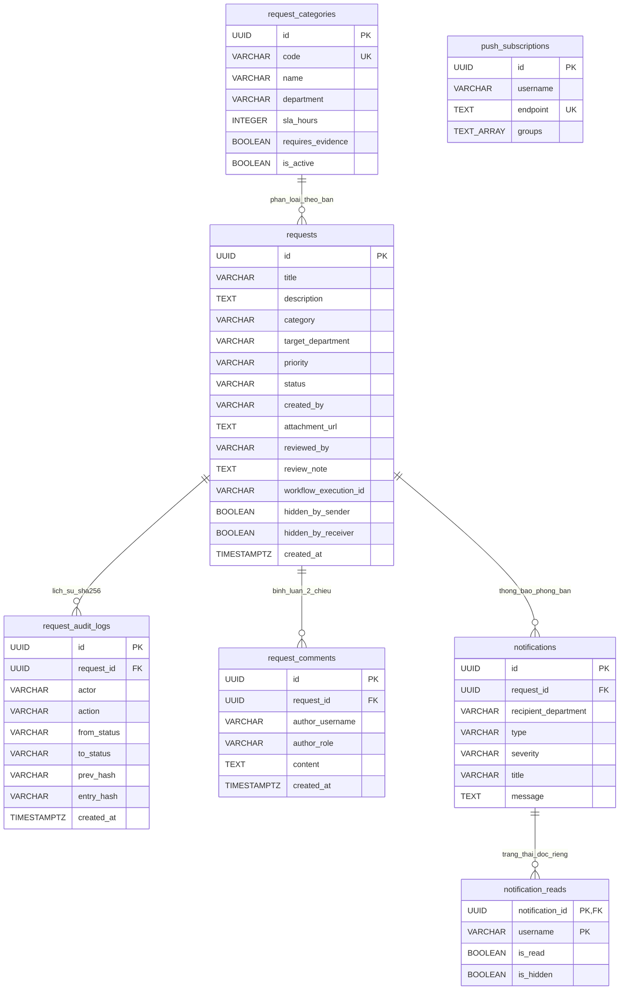

# Bước 2: Thiết kế Kiến trúc 3 Tầng DX-OS, Module & Cơ sở Dữ liệu

Tài liệu này trình bày bước thứ hai trong quy trình 7 bước phát triển dự án **UniRequest-OS: Nền tảng Quản lý Yêu cầu Đại học (Student Request Management)**: thiết kế kiến trúc 3 tầng, phân rã các module trong Backend/Frontend, thiết kế lược đồ 7 bảng PostgreSQL 16 và bảng quy ước REST API & mã lỗi.

---

## 1. Thiết kế Kiến trúc 3 Tầng & Phân rã Module

Nhóm lựa chọn kiến trúc **3 tầng tách biệt giữa hạ tầng dịch vụ lõi và ứng dụng nghiệp vụ**:
- **Tầng 1 (Hạ tầng dịch vụ lõi - Headless Core):** Gồm `Keycloak 26.0` (xác thực OIDC & quản lý cây nhóm phòng ban), `Kong Gateway 3.7.1` (cổng API kiểm tra giới hạn tần suất gọi API Rate-Limit, chặn tuyến nội bộ `/api/internal/*` từ ngoài và gắn mã truy vết `X-Correlation-ID`), `Kestra OSS v2.0.11` (điều phối 3 quy trình YAML), `PostgreSQL 16` và `MinIO S3` (`pgsty/silo`, bucket Private).
- **Tầng 2 (Các module nghiệp vụ dùng chung `H-P-D-I`):** Nằm trong `apps/backend-api/src/`, trong đó Express Backend (`auth-middleware.ts`) xác minh chữ ký JWT `RS256` từ JWKS của Keycloak, còn các dịch vụ còn lại được chia thành các module độc lập theo chức năng:

| Tên module / Tệp mã nguồn | Nhóm `H-P-D-I` | Trách nhiệm chính | Module phụ thuộc |
| :--- | :---: | :--- | :--- |
| `middlewares/auth-middleware.ts` | `[H]` | Kiểm tra chữ ký token JWT `RS256` bằng khóa công khai của Realm Keycloak, trích xuất `preferred_username`, `roles`, `groups`. | `config/environment.ts` |
| `services/keycloak-group-service.ts` | `[H/P]` | Kết nối Keycloak Admin API để lấy cây nhóm phòng ban đệ quy, chuẩn hóa đường dẫn phòng ban (`resolveTargetDepartmentPath`). | `config/environment.ts` |
| `services/request-service.ts` | `[P/D]` | Phân giải 3 phạm vi truy cập (`ALL`, `DEPARTMENT`, `PERSONAL`), xử lý tạo/duyệt/từ chối yêu cầu, xóa độc lập 2 phía và thống kê 7 ngày. | `config/database.ts`, `utils/audit-hash-chain.ts` |
| `services/category-service.ts` | `[P]` | Quản lý danh mục loại yêu cầu tách riêng theo từng phòng ban (`request_categories`). | `config/database.ts` |
| `utils/file-security.ts` | `[D]` | Kiểm tra phần mở rộng và kiểm tra chữ ký file thật (`Magic Bytes`) trong bộ nhớ trước khi lưu lên MinIO để chặn file thực thi đổi đuôi. | `controllers/upload-controller.ts` |
| `utils/audit-hash-chain.ts` | `[D]` | Tính toán mã băm `SHA-256` nối tiếp (`prev_hash -> entry_hash`) và kiểm tra tính toàn vẹn của lịch sử xử lý (`verifyAuditChain`). | `node:crypto` |
| `services/ai-triage-service.ts` | `[I]` | Gợi ý phòng ban, danh mục, mức ưu tiên bằng mô hình Ollama nội bộ kết hợp bộ phân tích từ khóa tiếng Việt (`< 5ms`). | `keycloak-group-service.ts`, `category-service.ts` |
| `services/workflow-service.ts` | `[P]` | Gửi sự kiện webhook sang Kestra (`unirequest-lifecycle`) với cơ chế dự phòng an toàn khi Kestra chưa sẵn sàng. | `config/environment.ts` |
| `services/notification-service.ts` & `push-service.ts` | `[H]` | Lưu thông báo theo phòng ban, phát sự kiện Socket.IO và gửi thông báo đẩy Web Push VAPID. | `realtime/socket-server.ts` |

- **Tầng 3 (Giao diện Cổng Quản lý Yêu cầu - `apps/demo-app`):** Ứng dụng `React 19 + TypeScript + Vite 8 PWA` được chia thành các phân hệ `features/requests`, `features/categories`, `features/dashboard`, `features/notifications` và phục vụ qua `Nginx Same-Origin Proxy` (`:3000`).

---

## 2. Thiết kế 7 Bảng Cơ sở Dữ liệu PostgreSQL 16

Lược đồ cơ sở dữ liệu được định nghĩa trong [`apps/backend-api/db/init.sql`](../../apps/backend-api/db/init.sql) và thư mục [`config/postgres/init/`](../../config/postgres/init):

---

## 3. Bảng Quy ước API & Mã Lỗi Kiểm tra Dữ liệu Đầu vào

Mọi dữ liệu gửi lên `RequestController` và `UploadController` đều được kiểm tra dữ liệu đầu vào ở cả giao diện và API với mã lỗi định danh rõ ràng:

| Mã lỗi (`code`) | HTTP Status | Điều kiện trả lỗi | Tệp kiểm thử xác minh |
| :--- | :---: | :--- | :--- |
| `TITLE_TOO_SHORT` | `400` | Tiêu đề yêu cầu rỗng hoặc ngắn dưới `5` ký tự sau khi `trim()`. | `request-controller-acceptance.test.ts` (#1) |
| `INVALID_PRIORITY` | `400` | Mức độ ưu tiên không nằm trong tập hợp lệ `NORMAL \| HIGH \| URGENT`. | `request-controller-acceptance.test.ts` (#2) |
| `EVIDENCE_REQUIRED` | `400` | Danh mục yêu cầu có `requires_evidence = true` (hoặc `FACILITY`) nhưng thiếu `attachment_url` và mô tả `< 15` ký tự. | `request-controller-acceptance.test.ts` (#3) |
| `URGENT_REASON_REQUIRED` | `400` | Chọn mức ưu tiên `URGENT` nhưng phần mô tả lý do ngắn dưới `10` ký tự. | `request-controller-acceptance.test.ts` (#4) |
| `INVALID_TARGET_DEPARTMENT` | `400` | Phòng ban tiếp nhận rỗng, vượt quá `150` ký tự hoặc không tồn tại trên cây nhóm Keycloak. | `request-controller-acceptance.test.ts` (#5) |
| `REJECT_REASON_REQUIRED` | `400` | Cán bộ chuyển trạng thái sang `REJECTED` nhưng không nhập `review_note` từ `5` ký tự trở lên. | `request-controller-acceptance.test.ts` (#6) |
| `ALREADY_PROCESSED` | `409` | Đơn không còn ở trạng thái `PENDING` và người thao tác không có quyền `admin`. | `request-controller-acceptance.test.ts` (#6) |
| `INPUT_TOO_SHORT` | `400` | Gọi `POST /api/requests/ai-suggest` với tổng độ dài tiêu đề và mô tả dưới `3` ký tự. | `security-owasp-audit.test.ts` (#4) |
| `UNSUPPORTED_OR_SPOOFED_FILE` | `400` | File tải lên có đuôi thực thi/script (`.exe`, `.sh`, `.svg`, `.html`...) hoặc chữ ký nhị phân `Magic Bytes` không khớp định dạng thật. | `file-security.test.ts` (`4/4` PASS) |

> Xem thêm tài liệu kiến trúc tổng thể tại [`docs/architecture.md`](../architecture.md) và bộ sơ đồ UML tại [`docs/uml.md`](../uml.md). Bước tiếp theo: [Bước 3 - Lập trình từng module & Giao diện người dùng](03-lap-trinh-tung-module.md).
