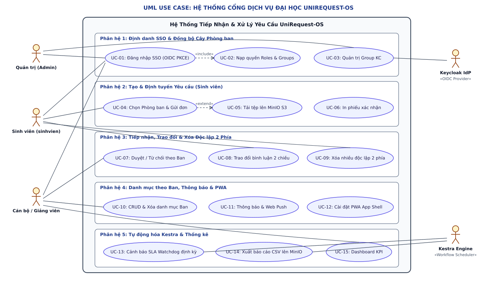
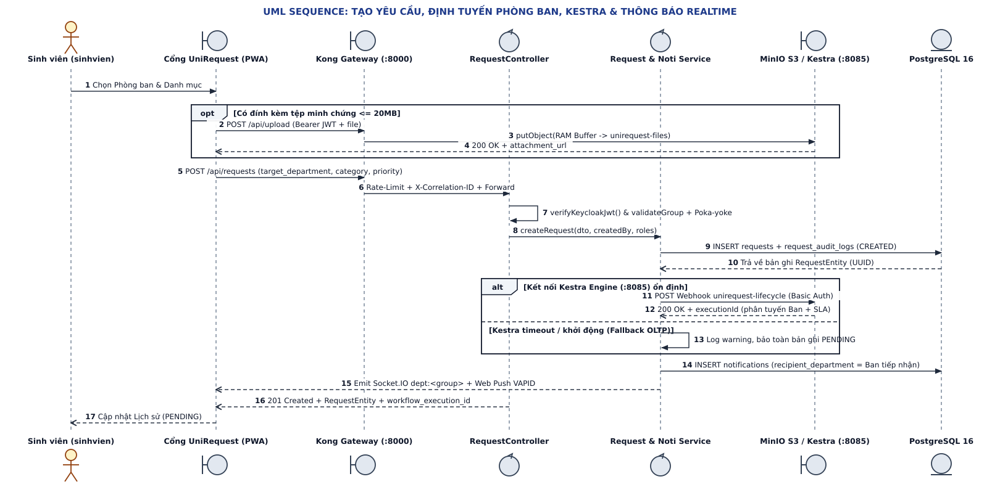
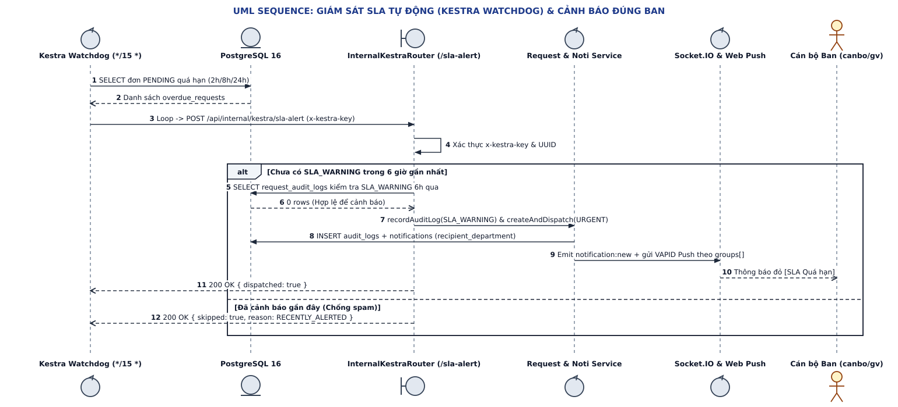
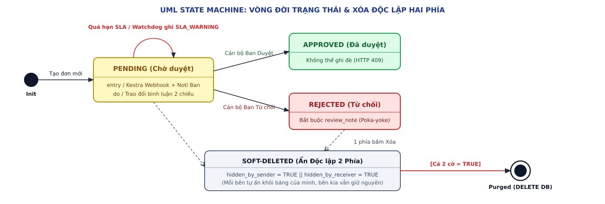
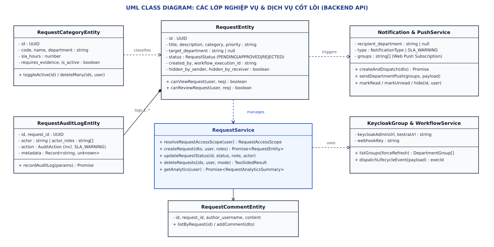
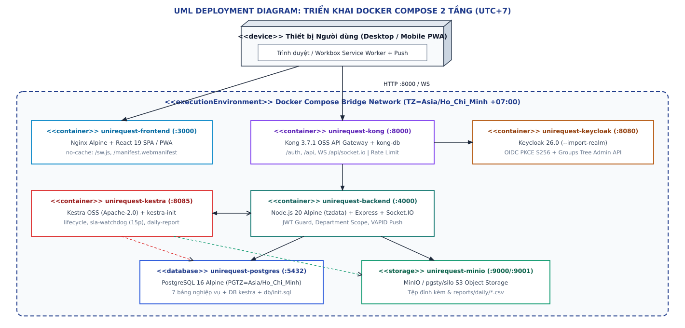

# Bộ Sơ đồ UML 2.x của Hệ thống - UniRequest-OS

Tài liệu này lưu trữ trọn bộ 6 sơ đồ UML 2.x theo ký hiệu chuẩn BCE (*Boundary - Control - Entity*) của dự án **UniRequest-OS: Nền tảng Quản lý Yêu cầu Đại học (Student Request Management)** nhằm giữ cho `README.md` gọn gàng, dễ theo dõi.

---

## 1. UML Use Case Diagram



---

## 2. UML Sequence Diagram (Chuẩn BCE)

### 2.1. Luồng Tạo yêu cầu, Gợi ý phân loại AI [I], Kiểm tra file tải lên, Kestra & Thông báo Realtime



### 2.2. Luồng Giám sát SLA tự động (Kestra Watchdog) & Chống cảnh báo trùng lặp



### 2.3. Mã nguồn Mermaid UML 2.x Sequence (`activate`/`deactivate`, `opt`, `alt/else`)

```mermaid
sequenceDiagram
    autonumber
    actor SV as Sinh vien (sinhvien)
    participant FE as Boundary - UniRequest Portal
    participant KONG as Boundary - Kong Gateway
    participant CTRL as Control - RequestController
    participant SVC as Control - Request, AI and Audit Service
    participant EXT as Boundary - MinIO / Kestra / Ollama
    participant PG as Entity - PostgreSQL 16

    opt Yeu cau AI goi y phan tuyen [I]
        FE->>+KONG: POST /api/requests/ai-suggest (title, description)
        KONG->>+CTRL: Verify Rate-Limit + X-Correlation-ID (Backend auth-middleware verify JWT RS256)
        CTRL->>+EXT: Ollama JSON / Local Semantic NLP Fallback
        EXT-->>-CTRL: suggested_department, category, priority, summary
        CTRL-->>-KONG: 200 OK + AiTriageSuggestion
        KONG-->>-FE: Auto-fill Phong ban, Danh muc, Uu tien
    end

    opt Co tep dinh kem
        FE->>+KONG: POST /api/upload (Bearer JWT + file)
        KONG->>+CTRL: Verify JWT RS256 + Magic Bytes RAM Inspection (file-security.ts)
        CTRL->>+EXT: putObject -> unirequest-files (Private bucket)
        EXT-->>-CTRL: 200 OK + Signed /api/upload/files/:objectName?exp&sig
        CTRL-->>-KONG: 201 Created + attachment_url
        KONG-->>-FE: 201 Created
    end

    FE->>+KONG: POST /api/requests (target_department, category, priority)
    KONG->>+CTRL: Forward + X-Correlation-ID (Backend verify JWT RS256 + validateKeycloakGroup)
    CTRL->>+SVC: createRequest(dto, createdBy, roles)
    SVC->>+PG: INSERT requests + request_audit_logs (SHA-256 chain)
    PG-->>-SVC: RequestEntity (UUID)

    alt Ket noi Kestra Engine on dinh
        SVC->>+EXT: POST Webhook unirequest-lifecycle
        EXT-->>-SVC: 200 OK + executionId
    else Kestra timeout / khoi dong (Fallback OLTP)
        SVC->>SVC: Log warning, bao toan PENDING trong DB
    end

    SVC->>+PG: INSERT notifications (recipient_department)
    PG-->>-SVC: OK
    SVC-->>FE: Emit Socket.IO dept + Web Push VAPID
    deactivate SVC
    CTRL-->>-KONG: 201 Created
    KONG-->>-FE: 201 Created + RequestEntity
    FE-->>-SV: Cap nhat Lich su (PENDING)
```

---

## 3. UML State Machine Diagram (Vòng đời & Xóa độc lập 2 phía)



---

## 4. UML Class Diagram (Các lớp nghiệp vụ Backend API)



---

## 5. UML Deployment Diagram (Hạ tầng Docker Compose 3 Tầng)


